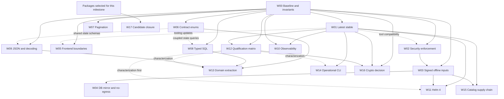

# Plan 032: Technology-guide alignment and latest-stable modernization

> **Status:** IN PROGRESS — implementation authorized 2026-10-09 on `implement/032-technology-guide`; [execution evidence](./032-evidence/README.md).
> **Prepared:** 2026-10-09.
> **Main repository baseline:** `3b378ef16141b9eaac35a1e5fe292e061b69f5f1`.
> **Catalog baseline:** `3e24ab98f0805bd54d6591d9b9b961bbfd1f5db5`.
> **Scope:** Astronomer application, operator console, agents, delivery, catalog, packaging, supporting test infrastructure, and release qualification.
> **Primary reference:** [Technology Selection Guide](https://technology-selection-guide.aws.ablabs.io/).
> **User direction:** follow latest stable technology releases rather than the guide's historical version snapshot; preserve CNPG and Astronomer-specific product architecture.
> **Artifact type:** one comprehensive master plan, with independently executable work packages and checklists. This document does not report those tasks as completed.

**Navigation:** [preserved architecture](#3-product-architecture-that-must-be-preserved) · [guide coverage](#4-guide-interpretation-and-coverage) · [latest-stable inventory](#6-latest-stable-policy-and-starting-inventory) · [work packages](#8-detailed-implementation-work-packages) · [execution phases](#9-execution-phases-pr-slices-and-decision-gates) · [verification](#10-verification-commands-and-evidence-contracts) · [stateful migrations](#11-stateful-migration-and-preservation-runbooks) · [completion ledger](#12-progress-ledger-and-completion-rules) · [references](#15-references-and-further-reading) · [first regression slices](#19-bounded-first-regression-slices-for-high-impact-fixes).

## 1. Outcome and reasoning

Astronomer should implement the guide's useful engineering guarantees while retaining the architecture that makes it Astronomer. The product adopts existing Kubernetes clusters, owns intent, approvals, policy, placement, operations, audit, and normalized status, and delegates downstream convergence to local Flux. PostgreSQL is authoritative for product state; CNPG remains the supported production manager for that database.

The October 2026 review found a modern foundation with incomplete adoption at important boundaries. JWT rotation/revocation, encryption-key rotation, generated OpenAPI clients, real backend tests, structured logs, tracing, signed release artifacts, and Flux assignments already exist. This plan strengthens those implementations rather than replacing them with a generic guide reference application.

The highest-priority work addresses functional and trust defects: mirrored artifacts not driving disconnected built-in provisioning; unsigned application-catalog import; non-blocking gosec findings; duplicated/outdated runtime versions; incorrect install documentation; inconsistent delivery states; non-progressing offset pagination; and an unbounded shared authentication refresh.

The broader modernization establishes one latest-stable component policy, a complete disconnected runtime supply chain, consistent generated contracts, better qualification evidence, and domain boundaries that can support the forthcoming v2 refactor. Modernization is staged so maintainable v1 changes do not accidentally become public API breaks or a database reset.

### Success definition

- [ ] New release candidates use the latest stable selected runtimes and tools, with upstream release discovery and qualification recorded.
- [ ] CNPG remains the production PostgreSQL manager; supported external PostgreSQL remains an explicit operator choice.
- [ ] Existing CNPG databases, PVCs, keys, credentials, and backup histories survive ordinary application upgrades.
- [ ] A fresh, uncached disconnected installation can adopt a cluster, install built-ins, scan workloads, and complete selected catalog operations without public egress.
- [ ] Authentication, tenant authorization, audit, durable operations, and assignment fencing retain their current security guarantees.
- [ ] Delivery enum values and generated consumers agree with database constraints.
- [ ] Every supported list makes progress or reports an explicit bounded compatibility error.
- [ ] Security findings have enforced gates, review ownership, and scoped risk acceptance.
- [ ] Supported-browser and database-version claims have retained real evidence.
- [ ] Domain extraction and orchestration consolidation preserve behavior and have characterization coverage.
- [ ] Release qualification scope is honest and machine checked; existing release exceptions remain accurately recorded.
- [ ] Every work package has a source-bound evidence record and a reviewed completion verdict.

## 2. Execution contract

Read the entire document before assigning a work package. Sections W00–W17 are work packages, not a single unbounded implementation PR. Each package names its prerequisites, source paths, verification, and stop conditions.

A prerequisite means its required design and implementation/static checks are ready for the dependent slice. Final cross-package integration acceptance may complete jointly. For example, W03's verified loader and assets enable W04's disconnected harness; that harness then supplies final live acceptance for both W03 and W04. Likewise, W12 characterization precedes W11 migration, while W12 final qualification runs against the migrated candidate. Record IMPLEMENTATION READY separately from DONE so these gates neither create a dependency cycle nor imply unperformed qualification.

### 2.1 Working directories and source control

Main repository: `/root/astronomer-all/astronomer`.
Catalog repository: `/root/astronomer-all/astronomer-catalog`.
Supporting repositories: `astronomer-examples`, `astronomer-testbed`, and `astronomer-full-test-iac` under the workspace root.

The main repository's `plans/` directory has an unrelated purpose. This program belongs in `advisor-plans/`.

Before execution:

```bash
cd /root/astronomer-all/astronomer
git status --short
git rev-parse HEAD
git diff --stat 3b378ef16141b9eaac35a1e5fe292e061b69f5f1..HEAD -- cmd internal frontend deploy scripts .github docs Makefile go.mod go.sum
git -C ../astronomer-catalog status --short
git -C ../astronomer-catalog diff --stat 3e24ab98f0805bd54d6591d9b9b961bbfd1f5db5..HEAD
```

Expected: identify all source drift and existing uncommitted work. A changed SHA is not automatically a reason to stop; reconcile affected evidence and task assumptions. Stop the affected package if its design premise no longer matches code. Preserve unrelated changes.

- [ ] Create one isolated branch/worktree per bounded package or compatible PR slice.
- [ ] Record base commit, owning repository, source hash, dependencies, owner, and evidence location.
- [ ] Reconcile overlapping existing plans before implementation; do not duplicate completed changes.
- [ ] Re-run applicable verification after rebases or dependency merges.
- [ ] Keep generated output changes paired with canonical source changes.
- [ ] Merge dependent slices in dependency order.
- [ ] Remove worktrees only after preserving needed uncommitted work and verifying merged state.
- [ ] Avoid accumulating abandoned validation branches or silently replacing another executor's changes.

### 2.2 Existing-plan reconciliation

Relevant existing programs:

- [016 — production/GA closure](016-production-ga-closure-master-plan.md).
- [026 — platform robustness/workflow closure](026-platform-robustness-and-workflow-closure.md).
- [027 — operator navigation/workflow closure](027-operator-navigation-and-workflow-closure.md).
- [028 — all-offerings qualification](028-all-offerings-api-qualification.md).
- [029 — independent-cluster functional qualification](029-two-cluster-offering-install-and-functional-validation.md).
- [030 — efficiency and operational readiness](030-efficiency-and-operational-readiness.md).
- [031 — UI refinement](031-ui-refinement-and-design-system-depth.md).

Their index rows contain historical status, not fresh proof of the current checkout. This plan supplies the October 9 modernization scope and must reuse their useful tests, fixtures, and evidence. It does not reopen completed UI migration, Flux replacement, or Charlie platform-pack work.

- [ ] Map each new task to an existing residual, an independently completed outcome, or genuinely new work.
- [ ] Mark an already-satisfied task complete only with current code and applicable evidence.
- [ ] Link historical evidence as historical; never attribute it to a changed candidate.
- [ ] Update the advisor index with current execution status without rewriting historical results.

### 2.3 Change and evidence rules

- Never copy secret values, tokens, private Helm values, authentication state, backup plaintext, or credential-bearing URLs into this plan, PRs, issues, screenshots, or public artifacts.
- Use owner-readable temporary storage for private rehearsal material; publish only redacted, closed-schema evidence.
- Do not disable validation, raise complexity baselines, add broad lint suppressions, or weaken production checks to make a modernization pass.
- Source locations below are baseline references. Re-open actual code before making each edit.
- Stop a package when it requires a product contract change beyond its scope; record the dependency and continue independent authorized work.
- Creating implementation PRs, deployment, tagging, and publication are separate execution actions. Writing this plan does not perform them.
- Preserve released immutable artifacts. Changed binaries require a new release identity and fresh qualification.

## 3. Product architecture that MUST be preserved

These constraints are acceptance criteria, not optional preferences.

| Area | Preserved decision | Consequence for this program |
| --- | --- | --- |
| Product boundary | Adopt and operate existing clusters | No new cluster-provisioning subsystem, CAPI dependency, or Crossplane platform merely to match the guide |
| Production database | CNPG-managed PostgreSQL | Keep CNPG Cluster/backup integration, production mode, storage, authentication, and recovery semantics |
| External database | Explicit supported external PostgreSQL | Retain external DSN/CA/Secret ownership and readiness behavior |
| Development database | Bundled PostgreSQL is development-only | Do not promote a standalone StatefulSet into the production default |
| Cache/queue | Valkey-compatible Redis protocol; Asynq and durable outboxes | No accidental return to a different Redis production engine; preserve Sentinel/external modes and outage recovery |
| Delivery | Local Flux source/kustomize/helm controllers | No Fleet, Argo, central remote kubeconfig executor, or speculative dual-engine provider |
| Agent transport | Outbound authenticated cluster identity and tunnel | Preserve least privilege, registration, credential rotation, session ownership, generation fences, bounds, and reconnect behavior |
| Product state | PostgreSQL is authoritative | Do not reconstruct authoritative intent from Flux objects or move durable operation state into caches |
| API | Versioned REST/OpenAPI plus existing WebSocket/SSE | Retain CLI/SDK/Charlie/browser compatibility; no parallel Connect transport |
| Frontend | React, Vite, TanStack Router/Query/Form, existing UI primitives | No second router, form framework, global server-state cache, or design-system replacement |
| Logging/migrations | slog and golang-migrate | Improve enforcement and schemas without installing a second logging abstraction or migration ledger |
| Tracing | OTLP/HTTP with W3C propagation | Preserve transport/redaction/sampling/shutdown semantics |
| Runtime images | Hardened approved bases, immutable release identities | Latest-stable selection feeds reviewed digests; no mutable package upgrade during production startup |
| Object storage | S3 API; RustFS-compatible operation | Do not introduce a mandatory MinIO runtime; preserve AWS S3 and other qualified S3-compatible endpoints |
| Charlie | Existing Product Bridge contract and qualified artifacts | Keep authorization, findings, durable actions, version negotiation, and redaction at the integration boundary |
| Kubernetes tools | Astronomer-owned installation/upgrade operations | Preserve inventories, ownership, adoption vs install, policy, overrides, and normalized operational status |
| Release | Signed manifests, images, SBOMs, provenance, upgrade/restore evidence | Do not bypass scans or rewrite published artifacts |
| Compatibility | v1 supported public contracts; deliberate v2 changes | Guide pre-production advice does not permit breaking released v1 consumers |

References: [contributor guide](../AGENTS.md), [Flux ADR](../docs/architecture/decisions/flux-native-delivery.md), [frontend ADR](../docs/architecture/decisions/frontend-application-stack.md), [Go tooling ADR](../docs/architecture/decisions/go-platform-tooling.md), [FIPS boundary](../docs/architecture/fips-cryptography-boundary.md), [compatibility contract](../deploy/release/compatibility.yaml).

### 3.1 CNPG preservation checklist

- [ ] Retain `postgres.mode: cloudNativePG` in the production profile.
- [ ] Retain `deploy/chart/templates/postgres-cnpg.yaml` and scheduled-backup semantics.
- [ ] Keep the CNPG operator ownership boundary explicit; do not install, upgrade, or uninstall an existing shared operator as an incidental application action.
- [ ] Retain externally managed Barman Cloud plugin/ObjectStore credentials and configuration.
- [ ] Preserve cluster name, storage class, PVC identity, WAL storage, instance count, synchronous-replication policy, service names, and application DSNs unless a reviewed migration explicitly changes them.
- [ ] Preserve database users, Secret references, certificate trust, connection limits, pool sizing, monitoring, backups, and recovery configuration.
- [ ] Keep CNPG operator upgrades distinct from PostgreSQL server-major upgrades and Astronomer schema migrations.
- [ ] Keep logical management backups and encryption-key recovery; they are not replaced by an untested CNPG/PITR configuration.
- [ ] Keep clean-restore and decryption rehearsals after database/image/migration changes.
- [ ] Refuse major PostgreSQL upgrades by changing `imageName` on an existing data directory without the supported CNPG procedure.
- [ ] Treat a restored CNPG cluster as a new controlled recovery target; never enable recovery bootstrap against an initialized live cluster.
- [ ] Rehearse primary failover and application reconnection with real CNPG when updating its operator, plugins, server major, or connection model.
- [ ] Record qualified CNPG/PostgreSQL/plugin/extension combinations, including airgap images.

## 4. Guide interpretation and coverage

The guide has RFC 2119 prescriptions and May 2026 snapshots. User direction overrides those historical pins. Strict literal differences remain documented; an accepted alternative is not called literal conformance when the guide says MUST use something else.

| Chapter | Current assessment | Implementation packages |
| --- | --- | --- |
| [01 Architecture](https://technology-selection-guide.aws.ablabs.io/01-architecture/) | Domain ownership/composition need completion; adopted-cluster boundary remains | W00, W13 |
| [02 Data](https://technology-selection-guide.aws.ablabs.io/02-data/) | pgx/sqlc/rotation exist; SQL discovery, JSON validation, database parity incomplete | W08, W09, W12, W13 |
| [03 Surface](https://technology-selection-guide.aws.ablabs.io/03-surface/) | REST is deliberate; enum/cursor/decoder guarantees need closure | W06, W07, W09 |
| [04 Infrastructure](https://technology-selection-guide.aws.ablabs.io/04-infra-tooling/) | Strong Make/build/lint foundation; version duplication and Helm transition remain | W01, W02, W11, W14 |
| [05 Observability](https://technology-selection-guide.aws.ablabs.io/05-observability/) | Logs/metrics/traces exist; dev components/support and coverage need renewal | W10 |
| [06 Security](https://technology-selection-guide.aws.ablabs.io/06-security/) | Auth is substantial; gates/freshness/FIPS decision gaps | W01, W02, W03, W05, W16 |
| [07 Testing](https://technology-selection-guide.aws.ablabs.io/07-testing/) | Real tests exist; DB/browser/disconnected/support evidence incomplete | W04, W12, W17 |
| [08 Discipline](https://technology-selection-guide.aws.ablabs.io/08-discipline/) | Preserve ADRs and released compatibility; broaden bounded inventories | W00, W06–W09, W13–W17 |
| [09 Airgap](https://technology-selection-guide.aws.ablabs.io/09-airgap/) | Strong release kit; provisioning/catalog/DB delivery incomplete | W03, W04, W17 |
| [10 TypeScript](https://technology-selection-guide.aws.ablabs.io/10-typescript/) | Modern core; tooling, cancellation, forms, runtime boundary gaps | W01, W05, W06, W12 |
| [11 Multi-language](https://technology-selection-guide.aws.ablabs.io/11-multi-language/) | Long shell programs, catalog Python controls, Helm4 migration | W11, W14, W15 |

### 4.1 Deliberate alternatives

- Preserve REST/OpenAPI rather than add Connect/protobuf. Use the canonical OpenAPI contract to achieve categorical typing, generated operations, error contracts, and compatibility checks.
- Preserve TanStack Router and Form; the guide explicitly accepts TanStack routing as an alternative, and the existing ADR assigns clear ownership.
- Preserve slog, golang-migrate, OTLP/HTTP, and the approved Alpine runtime strategy. Revisit a runtime-base choice only with a measured requirement and its own ADR.
- Keep explicit Compose reload unless a separately justified inner-loop improvement preserves the single startup path.
- Do not install Crossplane/CAPI: cluster provisioning is outside Astronomer's product boundary.
- Preserve versioned encryption envelopes and rotation; review Fernet/age/FIPS as cryptographic product decisions, not an unannounced ciphertext rewrite.
- No requirement for direct Loki push when a supported log shipper exists.
- No requirement for a specific testcontainers/pgtestdb brand if the selected harness provides real backend execution, production-version fidelity, independent isolation, cleanup, and mandatory integration coverage. Document the literal departure.
- Do not infer that Sigstore's short-lived signing certificate must be unexpired today: verify trusted signing-time/timestamp/transparency evidence according to Sigstore semantics. An invented unsigned bundle-expiry field is not a substitute for correct signature verification.

## 5. Evidence ledger from the baseline review

| ID | Finding and source evidence | Confidence / impact boundary |
| --- | --- | --- |
| E01 | Go 1.26.6 in [go.mod: 3](../go.mod#L3), duplicated in [server Dockerfile: 2](../deploy/docker/Dockerfile.server#L2) and other builders | High; outdated inputs and duplication |
| E02 | Semver-major ignores in [.github/dependabot.yml](../.github/dependabot.yml) | High; current automation cannot maintain latest stable majors |
| E03 | [gosec workflow: 33](../.github/workflows/security-analysis.yaml#L33) uses `-no-fail`; no following severity enforcement | High; findings do not fail this job |
| E04 | GitHub main branch protection returned 404 and rulesets returned [] on 2026-10-09 | High at review time; external state must be rechecked |
| E05 | [built-in provisioner: 107](../internal/delivery/builtin/provisioner.go#L107) loads embedded catalog; sources/values remain public | High static evidence; disconnected runtime not newly exercised |
| E06 | [mirror projection: 255](../internal/releasecontract/manifest.go#L255) rewrites agent/Flux/bundle identities, not consumed catalog/chart/value inputs | High; actual runtime wiring needs remediation |
| E07 | [built-in catalog: 38](../deploy/bundles/catalog.json#L38) points Trivy DB and Java DB to public GHCR | High; clean offline DB supply absent |
| E08 | [application catalog import: 101](../scripts/application-catalog-airgap.sh#L101) extracts before internal unsigned checksum validation | High; authenticity/trust-order gap; no exploit claim |
| E09 | [airgap runbook: 137](../docs/airgapped-install.md#L137) expects fresh_only/six; [release validator: 273](../internal/releasecontract/manifest.go#L273) expects fresh_and_upgrade/seven | High; documented command rejects v1.2.1 |
| E10 | [OpenAPI delivery state: 10814](../docs/openapi.yaml#L10814), [Go state sets: 225](../internal/delivery/model/rollout.go#L225), and [DB CHECK: 2233](../internal/db/migrations/001_initial.up.sql#L2233) disagree | High contract mismatch; occurrence of DB-only states not proved |
| E11 | [offset ceiling: 114](../internal/handler/response.go#L114), [catalog list: 203](../internal/handler/catalog_queries.go#L203), [next offset: 38](../internal/pagination/page.go#L38) | High contradictory continuation; no large live data experiment |
| E12 | [transport refresh: 109](../frontend/src/lib/api/transport.ts#L109) queues callers behind unbounded standalone Axios refresh | High; stalled request can retain queue |
| E13 | [query cancellation gate: 12](../scripts/check-frontend-query-cancellation.mjs#L12) covers 10 named modules; [tool hooks: 28](../frontend/src/lib/hooks/tools.ts#L28) drop signals | High; incomplete adopted guarantee |
| E14 | [SIEM modal: 73](../frontend/src/routes/dashboard/settings/siem/-forwarder-modal.tsx#L73), [alert modal: 108](../frontend/src/routes/dashboard/alerting/-channel-modal.tsx#L108), [form gate: 23](../frontend/src/components/ui/__tests__/form-adoption.test.ts#L23) | High; toast-only modal failure and incomplete inventory |
| E15 | [ResourceHandler: 32](../internal/handler/resources.go#L32) spans multiple domains; 340 top-level production files/~99,799 lines | High ownership/verification cost; not proof all handlers are wrong |
| E16 | [systemrollout SQL: 162](../internal/delivery/systemrollout/service.go#L162), [catalogapp service](../internal/delivery/catalogapp/service.go), [governance scan: 14](../scripts/check-data-governance.py#L14) | High; domain SQL bypasses canonical query discovery; no injection claim |
| E17 | [durable JSON validator: 148](../internal/db/migrations/049_durable_json_governance.up.sql#L148), [alert reader: 898](../internal/worker/tasks/alert_evaluation.go#L898), [handler reader: 221](../internal/handler/alerting_inhibitions.go#L221) | High ignored errors/shallow schema; operational frequency unproved |
| E18 | [strict decoder: 94](../internal/handler/validate.go#L94) versus [user creation: 133](../internal/handler/users.go#L133) and other permissive endpoints | High consistency gap; existing domain checks remain |
| E19 | [browser support: 113](../deploy/release/compatibility.yaml#L113) versus [Chromium projects: 40](../frontend/playwright.config.ts#L40) | High absence of automated other-engine paths; historical manual coverage unreviewed |
| E20 | [PG integration runner: 25](../scripts/test-postgres-integration.sh#L25) uses PG16; [chart values](../deploy/chart/values.yaml) select PG17.11 for CNPG | High version-parity gap; other release tests exist |
| E21 | [telemetry Compose: 19](../deploy/docker-compose.telemetry.yml#L19) has old components and EOL Promtail | High; development stack, not all production monitoring |
| E22 | 65 owned shell scripts; 18 above 200 lines; [live browser runner](../scripts/test-live-browser.sh) 884 lines | High; lifecycle/type/testability cost |
| E23 | [catalog requirements](../../astronomer-catalog/requirements-dev.txt) and [workflow: 15](../../astronomer-catalog/.github/workflows/validate.yaml#L15) lack complete Python lock and equivalent gates | High; supporting metadata-build supply chain |
| E24 | [FIPS ADR: 8](../docs/architecture/fips-cryptography-boundary.md#L8) explicitly excludes v1 FIPS artifacts | High; deliberate unsupported capability, not false certification |

## 6. Latest-stable policy and starting inventory

Values below are discovery results dated 2026-10-09, not permanent target pins. Re-resolve stable versions before the applicable upgrade PR. Record both upstream version and the exact validated build/image digest.

| Component | Baseline | Stable at review | Required approach |
| --- | --- | --- | --- |
| Go | 1.26.6 | 1.27.2 | Update compiler, builders, lint/scan compatibility, generated tools, all binaries/images |
| Node | 24.21.0 LTS | 26.11.1 Current | User wants latest stable; use Current track for this static frontend build, update Node-major ADR |
| npm | 11.19.0 baseline | 12.2.0 | Qualify lockfile/tooling behavior with chosen Node |
| TypeScript | 6.0.3 | 7.0.2 | Characterize compiler/plugin compatibility; retain strict checking |
| ESLint | 9.39.5 | 10.12.0 | Migrate config/plugins without weakening rule policy |
| Vite | 8.3.0 | 8.3.4 | Refresh lock/build/CSP/bundle/browser checks |
| Vitest | 5.0.0 | 5.0.3 | Preserve assertion/timeout/retry policy |
| React/ReactDOM | 19.3.0 | 19.3.0 | Already current; preserve architecture |
| Tailwind | 4.3.3 | 4.3.3 | Already current |
| TanStack Query | 5.102.8 | 5.104.1 | Refresh plus cancellation/ownership regression tests |
| TanStack Router | 1.170.35 | 1.170.41 | Refresh generator/plugin together |
| TanStack Form | 1.33.5 | 1.33.5 | Already current; finish integration |
| Playwright | 1.63.0 | 1.64.0 | Resolve supported browser executables with runner version |
| Helm | SDK 3.21.4/CLI 3.21.0 | 4.3.0 | Split CLI, embedded SDK, and Flux-owned Helm runtime qualifications |
| golangci-lint | 2.12.2 | 2.14.0 | Single tool inventory; retain STANDARD/nontruncated findings |
| sqlc | 1.31.1 | 1.31.1 | Already current; preserve generation |
| pgx | 5.9.2 | 5.11.0 | Update with real DB/transaction/trace tests |
| OTel | 1.45.0 | 1.47.0 | Keep HTTP transport and resource/redaction/sampler behavior |
| otelpgx | 0.10.0 | 0.13.0 | Check query trace interface/context behavior |
| Kubernetes/client-go | support 1.33–1.35/libs 0.36.3 | K8s 1.37.1/client-go 0.37.1 | Add qualification before advertising; preserve skew rules |
| k3s | local 1.35.7+k3s1 | 1.37.1+k3s1 | Disposable qualification first; native cluster migration separate |
| CNPG operator | Inventory installed vs contract | 1.30.1 | Keep CNPG; operator/API/plugin qualification |
| PostgreSQL | CNPG 17.11 | 18.6 | CNPG-supported major-upgrade rehearsal; keep patched existing 17 until approved migration |
| Flux | 2.9.6 | 2.9.6 | Already current; preserve vendor trusted distribution |
| Trivy | 0.75.0 | 0.75.0 | Already current; version updates separate from DB freshness |
| Trivy operator | 0.35.0 | 0.35.0 | Already current at review; chart/operator version namespaces differ |
| Fluent Bit | 5.1.3 | 5.1.3 | Already current; preserve validated logging |
| RustFS | Inventory fixtures/customer deployment | 1.0.1 | Keep S3 boundary; qualify selected build and feature compatibility |
| Python | catalog 3.12 | 3.15.0 published Oct 9 | Recheck availability/time/platform deps; latest stable decision, not beta |
| Grafana/Tempo/Loki/Prometheus | 11.5.2/2.7.2/3.4.2/3.2.1 dev | 13.2.3/3.1.0/3.7.8/3.15.0 | Update dev stack and compat configs; inventory production separately |
| Promtail | 3.4.2 dev | EOL March 2, 2026 | Replace with supported shipper; Alloy 1.20.1 or existing Fluent Bit path |

Do not treat the table as proof an upstream image scans clean or an existing customer can safely perform a major upgrade. Re-scan exact artifacts. A new PostgreSQL major requires a real data migration; a new Kubernetes minor requires admission, APIs, agent, Flux, tool, storage, and backup qualification.

### Required version semantics

- Latest stable excludes prerelease/nightly/canary tags.
- Selection is updated through a reviewed change; qualification records what was selected.
- Published artifacts remain immutable, with exact lockfiles, digests, signatures, SBOMs, and provenance.
- An upstream security fix that exists should be adopted promptly. A known upstream vulnerability with no fixed newer artifact follows the user's waiver policy; it is not mislabeled fixed.
- A compatibility delay is recorded by component, owner, upstream target, blocker, evidence, and review date. Do not silently reinterpret latest stable as forever staying on a preferred major.
- Database and cluster majors use a migration workflow. Latest-stable discovery never automatically restarts a customer database or upgrades a shared cluster.
- Offline deployments import signed update sets; they do not need an online resolver at runtime.
- Every dependency graph, including catalog Python, test harnesses, DR/shell images, and upstream controllers, is part of the inventory.

## 7. Work-package map and dependency graph

| Package | Outcome | Priority | Effort / risk | Depends on | Status |
| --- | --- | --- | --- | --- | --- |
| W00 | Baseline, guide exceptions, product invariants, evidence inventory | P0 | M/LOW |—| DONE |
| W01 | Latest-stable inventory and runtime/dependency updates | P0 | L/MED | W00 | IMPLEMENTATION READY |
| W02 | Enforced security gates and policy-bound waivers | P0 | M/MED | W00; tool compat W01 | IN PROGRESS |
| W03 | Runtime-consumed signed mirrored catalogs and complete asset closure | P0 | L/HIGH | W00, W02 trust policy | IN PROGRESS |
| W04 | Offline Trivy DB lifecycle and no-public-egress qualification | P0 | L/MED | W03 | IN PROGRESS |
| W05 | Bounded refresh, transport cancellation, accessible modal forms | P1 | M/MED | W00; W01 frontend tooling | DONE (scoped) |
| W06 | Authoritative delivery and categorical enums | P1 | M/MED for delivery; L for inventory | W00 | DONE (scoped) |
| W07 | Complete scope-bound cursor pagination | P1 | L/MED | W00 | IN PROGRESS |
| W08 | Typed domain SQL and complete governance discovery | P1 | L/MED | W00; W06 where coupled | DONE (scoped) |
| W09 | Strict request adoption and durable JSON reader validation | P1 | L/MED | W00; W06 for shared state schemas | DONE (scoped) |
| W10 | Supported observability stack and measured signal coverage | P1/P2 | L/MED | W01; W00 reconciliation with Plan 030 | IN PROGRESS |
| W11 | Helm 4 migration while preserving Flux and CNPG | P1 | L/HIGH | W01, W03; W12 characterization before migration and qualification before production acceptance | TODO |
| W12 | Production-version DB, CNPG, browser, test report qualification | P1 | XL/HIGH for stateful work | W00, W01; candidate-specific W03–W11 as applicable to final qualification | IN PROGRESS |
| W13 | Backend domain extraction for v2 | P2 | XL/HIGH | W06, W08, W09; W12 characterization | TODO |
| W14 | Typed operational CLI and small shell wrappers | P2 | XL/HIGH | W01; W12 characterization; W17 for release rehearsals | TODO |
| W15 | Catalog Python and supporting repo supply chain parity | P1/P2 | L/MED | W01, W03 | TODO |
| W16 | Explicit crypto/FIPS decision and optional artifact design | P2 | M for decision; XL/HIGH for claimed artifact | W00, W01, W12; product decision before optional implementation | DONE (ordinary v1 scope; conditional artifact not selected) |
| W17 | Exact candidate integration, deployment, release policy closure | P1 | L/HIGH | Applicable packages above | TODO |

The effort values are relative sizing, not delivery promises. W13/W14 contain multiple PRs and can span weeks. W16 is a gated design track; no implicit FIPS certification or forced cryptographic rewrite is authorized by this plan.



The graph shows preparation and characterization order. W12 final qualification exercises the integrated candidate after its applicable W03–W11 changes; it is not a requirement to finish every qualification lane before starting Helm implementation. W14 release rehearsals use W17 at the applicable milestone. The W17 dependency is the explicitly selected milestone scope, including W13/W14/W16 only when their outcomes are claimed.

W17 is run at milestone boundaries, not only after all v2 work. A bounded v1 milestone can close before W13/W14/W16 by explicitly excluding those outcomes from its release claim.

## 8. Detailed implementation work packages

### W00 — Establish the baseline, preserve product invariants, and reconcile prior work

**Priority:** P0. **Effort/risk:** M/LOW. **Owner:** technical lead with backend/platform/frontend reviewers. **Dependencies:** none.

**Why:** The guide cannot serve as an instruction to replace Astronomer's established architecture. Existing plan status and earlier evidence must be reconciled against today's source. This package prevents duplicate implementation, stale claims, and accidental feature removal.

**Scope:** `AGENTS.md`; `docs/architecture/README.md`; accepted ADRs and compatibility documentation; `deploy/release/compatibility.yaml`; an additive `docs/assurance/technology-guide/` evidence index during implementation; this plan's execution status. No application refactor in this package.

**Current-state exemplars:** the Flux ADR separates authoritative product state from reconciliation state; `internal/config/env_access_contract_test.go` enforces typed configuration ownership; `scripts/hash-source-tree.py` binds evidence to source. Reuse those patterns.

**Ordered tasks:**

- [x] W00.1 Record repository SHAs, dirty state, previous release/tag, deployed image identities, Helm revision, Kubernetes version, CNPG topology, Valkey mode, operator/plugin ownership, and evidence timestamps. Inspect only non-secret fields.
- [x] W00.2 Build an active component inventory: first-party binaries/images, chart/runtime images, Flux distribution, built-in charts/images, catalog artifacts, Charlie artifacts, database/cache/storage, development stack, release tools, Go/npm/Python graphs, and supporting repositories.
- [x] W00.3 Map all E01–E24 findings to current code and prior plans; close only those demonstrably fixed. Record rejected assumptions, including no claim of missing JWT refresh rotation or missing encryption-key rotation.
- [x] W00.4 Add a guide decision matrix: literal prescription, Astronomer decision, justification, owning ADR, review trigger, and enforcement test. Record alternative stacks honestly.
- [x] W00.5 Capture compatibility surfaces before changes: OpenAPI, generated SDKs, agent protocol/capabilities, CLI commands, durable JSON documents, database schema, source/trust identities, chart values, and released upgrade paths.
- [x] W00.6 Convert section 3 invariants into focused contracts or integration assertions where a regression has a meaningful failure mode. Reuse existing chart and production configuration tests; do not add text-mirroring tests merely to increase counts.
- [x] W00.7 Confirm ownership for work packages and shared files. No two executors simultaneously edit `go.mod`, frontend lockfile, `compatibility.yaml`, release schemas, or the same migration version.
- [x] W00.8 Record required local prerequisites and existing verification target names. New commands in this plan are proposed until implemented.

**Verification:** `make docs-check`, `make release-contract-check`, `make config-docs-check`, `make cli-docs-check`, `node scripts/check-dependency-boundaries.mjs`. Expected: exit 0, no unintended generated/source drift, no weakened contract. Preserve a checked inventory and current source references.

**Done:** baseline is source-bound, every finding has disposition, every preserved component has an owner and regression story, and no overlapping completed plan has been reimplemented.

**Stop:** live state differs materially from assumed database/ownership topology; a source/trust migration premise is false; preserving an invariant requires a missing design decision.

### W01 — Follow latest stable across runtimes, dependencies, tools, charts, and images

**Priority:** P0. **Effort/risk:** L/MED. **Dependencies:** W00. **Owner:** platform/tooling plus component owners.

**Why:** Existing version-alignment checks establish consistency, not freshness. Major upgrades are ignored, manually pinned components are uncovered, and Go builders duplicate a stale literal.

**Scope:** `go.mod`, `go.sum`, `Makefile`, `deploy/docker/Dockerfile.*`, `deploy/nginx/Dockerfile.nginx`, `frontend/Dockerfile`, frontend manifest/lock/`.nvmrc`, `.github/local-ci.Dockerfile`, active workflows, Dependabot config, tool check scripts, and proposed `deploy/toolchain/versions.json` plus schema/resolver/checker. Broader API/database migration belongs to its own package.

**Proposed inventory contract:**

- Each entry has stable component ID, ecosystem, upstream locator, selected version, supported platform set, resolved artifact/image digests, owning team, source consumers, discovery timestamp, verification provenance, and compatibility qualification requirement.
- Unresolved/latest tags never enter a published release manifest.
- Optional compatibility deferrals have reason, affected versions, owner, evidence, review date, and exit condition.
- Generator/source relationships are explicit. Choose exactly one version authority; generated consumers MUST be checked for drift.
- Keep tool/runtime locks separate from per-release immutable manifests; the former updates, the latter identifies released bytes.
- The inventory MUST validate unknown fields, duplicate IDs, invalid upstream/digests, prereleases, missing owners, and contradictions.
- Stable-discovery network access is a build/update task. Production startup MUST NOT fetch version metadata.

**Ordered tasks:**

- [x] W01.1 Implement inventory schema, deterministic serialization, official upstream resolvers, and offline `--check` mode. Capture release date and stable/prerelease status; reject future/ambiguous releases unless independently validated.
- [x] W01.2 Inventory every version consumer before replacing literals. Include tools started via `go run module@version`, actions SHA/comments, curl-installed CLIs, Docker args, docs, fixture images, CNPG operator/plugin, and embedded catalog versions.
- [x] W01.3 Implement proposed `make versions-check` for deterministic source/consumer alignment and `make updates` for human-readable stable discovery, including `go list -u -m all`. Add machine-readable update evidence; the checker does not require online access on every ordinary PR.
- [x] W01.4 Resolve Go latest stable; update `go.mod`, toolchain/builders, and compatible generators/linter. Derive builder selection from authoritative Go version and resolved digest rather than copying separate version strings.
- [ ] W01.5 Build all first-party Go tools/binaries, including migrator/key rotation/DR/shell helpers omitted by a simplistic server-only inventory. Test reachable vulnerabilities using the actual build toolchain.
- [x] W01.6 Update Go dependency families in coherent slices: pgx/otelpgx/OTel, Kubernetes/client-go/controller-runtime, authentication/crypto libraries, SDK/resolver/signature stacks. Review runtime changes, not only sums.
- [x] W01.7 Supersede the Node-major baseline ADR with latest stable Current for frontend build tooling. Update Node/npm, engines, version files, workflows, build images, local runner, and generated build metadata together.
- [x] W01.8 Upgrade TypeScript/ESLint/Vite/Vitest and compatible plugins in separate reviewable slices where needed. Preserve strict checking, cancellation gates, design-system restrictions, CSP checks, and bundle budgets.
- [x] W01.9 Refresh frontend dependency lockfile, router generator/plugin compatibility, Playwright/browser executables, UI primitives, and tested overrides. Remove obsolete overrides only after showing the original reason is resolved.
- [ ] W01.10 Expand automatic update discovery to Helm, manual CLIs, CNPG, Flux, Trivy, built-in apps, Charlie compatibility, dev stack, and supporting repositories. Use custom manager/resolver where Dependabot does not cover an ecosystem.
- [x] W01.11 Replace blanket major-ignore rules with reviewed update queues. Separate security-sensitive patch cadence from larger major qualification; recommend daily discovery and a weekly triage cycle.
- [x] W01.12 Add digest/provenance resolution and multiarch validation for selected images. A latest tag is a discovery input, never the final runtime identity.
- [ ] W01.13 For each lagging component, either qualify the current stable target or record the specific compatibility blocker. Do not silently preserve the old major as policy.
- [ ] W01.14 Add freshness dashboard/report data: selected/upstream version, discovery age, exception age, owner, deadline, and evidence. Fail release preflight if the review is missing/stale; offline release preflight validates the signed resolution record instead of contacting upstream.

**Tests:**

- Stable/prerelease/canary discrimination, unavailable upstream, changed release metadata, rate limiting, malicious/incomplete responses, duplicate inventory IDs, unsupported platform, and expired compatibility exceptions.
- Repeated resolution/check generates byte-identical output; mismatch in any builder/workflow/version file is detected.
- Latest stable discovery does not edit source without an explicit update operation.
- Go upgrades retain encrypted row decryption, JWT semantics, pgx transaction isolation, trace propagation, Flux materialization, and agent protocol tests.
- Frontend upgrades retain generated wire contract, static asset/CSP, route generation, cookie/CSRF, form focus, terminal, and streaming behavior.

**Verification:** `make versions-check` (new), `make updates` (new; informational network discovery), `make sqlc-check`, `make charlie-contract-check`, `make config-docs-check`, `go vet ./internal/... ./cmd/...`, applicable enterprise gates, frontend type/lint/unit/build/budget checks, and W12 real backend qualification.

**Done:** all selected targets have current discovery records; consumers derive/check against one authority; released artifacts retain immutable identity; no unreviewed runtime auto replacement exists.

**Stop:** latest compiler/framework cannot work with a required generator/plugin; upstream image lacks required architecture; stable metadata cannot be trusted; an upgrade requires a public API break or database format migration. Record the blocker and advance independent components.

### W02 — Enforce source security and merge policy, preserve scoped risk acceptance

**Priority:** P0. **Effort/risk:** M/MED. **Dependencies:** W00; W01 toolchain compatibility. **Owner:** security/platform.

**Scope:** `.github/workflows/security-analysis.yaml`, relevant PR/release workflows, security report parsers/tests, `.gitleaks.toml`, `deploy/release/runtime-image-waivers*`, license policy, `scripts/qualify-release-runtime-images.py`, `scripts/validate-automated-release.py`, release approval/runbooks. GitHub rulesets are external configuration applied only in a separate approved execution action.

**Reasoning:** Collection and enforcement are different responsibilities. Always retain source evidence, but a successful upload must not imply findings passed. Existing upstream-CVE acceptance remains supported; it is exact, disclosed, expiring, and testable.

**Ordered tasks:**

- [ ] W02.1 Capture current gosec results using the selected toolchain. Triage HIGH/MED findings by code path and rule; separate true defects, inaccessible/test only code, and documented standard platform behavior.
- [x] W02.2 Separate scan/report collection from severity/policy enforcement. Preserve SARIF on failed scans; fail for unaccepted HIGH findings. Decide MED behavior explicitly and document reviewed exceptions rather than blanket `-no-fail`.
- [x] W02.3 Produce govulncheck SARIF and enforce its actual reported reachable finding semantics. Do not invent severity fields the tool does not emit; enrich from trusted advisory metadata where needed.
- [ ] W02.4 Keep full-history redacted Gitleaks, safe checkout credentials, action digest pins, and reviewable allowlists. Test reverted-secret detection with synthetic nonsecret fixture values.
- [x] W02.5 Implement exceptions with rule/advisory IDs, scope, path or artifact digest, reason, owner/approver, release applicability, expiry, and verification evidence. Reject stale/unknown/duplicate/unmatched exceptions.
- [x] W02.6 Preserve upstream-CVE policy: adopt a fixed newer upstream artifact when available; otherwise retain findings and accept exact upstream risk without forcing an Astronomer fork. Record availability checks and renewed expiry decisions.
- [x] W02.7 Preserve v1.2.0/v1.2.1 qualification/license deferrals and published artifacts. Do not retrofit claims or automatically extend tag-specific exceptions to a new tag.
- [x] W02.8 Define future automated release-policy requirements and explicit deferred qualifications as data. Resolve whether a maintenance candidate follows a new approved automated policy or the currently strict future tag contract before publication; implementation/fixes continue independently.
- [x] W02.9 Specify a GitHub ruleset patch with exact stable check names, protected main, no force push/deletion, review policy, workflow permissions, and controlled break glass. Check fork PR/SARIF permissions and unavailable code-scanning features.
- [ ] W02.10 Validate ruleset/check identity against actual emitted workflow checks, avoiding merge queues or skipped jobs that make required checks impossible. Retain a machine-readable readback of applied settings.
- [x] W02.11 Set recommended security-response SLAs: daily triage for critical/exploited findings, target 3 days critical/7 days high where fix exists, with an owned documented exception for incompatibility or no fix. The release owner can select a different explicit SLA.
- [x] W02.12 Keep vulnerability, license, FIPS, and accessibility evidence distinct. A CVE waiver does not qualify a license or certify a cryptographic module.

**Negative tests:** unwaived HIGH produces nonzero exit; waived exact finding passes with findings retained; changed digest/new finding/expired exception fails; report upload still runs on failure; malformed SARIF/missing report fails closed; released tag-specific deferral rejected for unrelated tag.

**Verification:** proposed security policy unit tests; `python3 scripts/tests/qualify_release_runtime_images_test.py`; `python3 scripts/tests/validate_automated_release_test.py`; `python3 scripts/tests/validate_release_approval_test.py`; `make vulncheck`; `make release-contract-check`; applicable Local CI.
Expected: negative fixtures fail as intended, accepted fixtures pass, reports exist, no blanket bypass.

**Done:** policy enforcement is explicit and reproducible; external required checks have a reviewed/readback configuration when applied; waivers disclose unfixed findings; releases claim only validated qualifications.

**Stop:** a required finding has no valid disposition; GitHub permissions/features prevent the specified gate; evidence cannot bind to exact source/artifacts. Do not substitute a green placeholder job.

### W03 — Make verified mirrored artifacts authoritative for disconnected provisioning

**Priority:** P0. **Effort/risk:** L/HIGH. **Dependencies:** W00, W02 trust policy. **Owner:** delivery/platform.

**Scope:** `internal/delivery/builtin/provisioner.go` and tests; `deploy/bundles/embed.go`/`catalog.json`; `internal/config/`; `internal/releasecontract/`; existing resolver/verifier packages; `scripts/mirror-release.py`; `scripts/airgap-kit.py`; `scripts/application-catalog-airgap.sh`; release/catalog schemas; chart catalog configuration; airgap runbook. Proposed new verified distribution loader may be introduced adjacent to existing delivery artifacts, with one trust implementation.

**Current excerpts to verify:**

```go
// internal/delivery/builtin/provisioner.go:107
catalog, err := builtinbundles.Load()
// source identities later come from component.Source.URL
// renderer values later come from json.Marshal(component.Values)
```

```sh
# scripts/application-catalog-airgap.sh:101–104
tar -C "$work" -xzf "$bundle"
root="$work/application-catalog"
# The following SHA256SUMS is supplied by the same unverified archive.
```

These excerpts explain wiring/trust defects; they are not instructions to reproduce unsafe import.

**Design constraints:**

- Vendor-distributed artifacts are immutable and verified against pinned trust roots/identity and signing-time evidence.
- Customer mirror endorsement may add trust, but it does not erase the original vendor identity or permit digest changes.
- Customer-added repositories retain explicit product trust policy; do not label an unsigned user repository as vendor qualified or disable existing policy to make its import work.
- Mirroring changes locations, not content identities. Preserve original source identity as an audit field and bind rewrites to the source manifest digest.
- No public fallback is enabled in disconnected mode. Connected fallbacks are explicit, authenticated, logged, and policy controlled.
- Do not globally allow arbitrary private/IP destinations to resolve the existing public DNS restriction; use bounded trusted mirror policy and preserve SSRF controls.

**Ordered tasks:**

- [x] W03.1 Define one signed distribution/catalog contract for built-in chart archives, recursive chart dependencies, values profiles, runtime image inventory, CRDs, tools, operator/plugin assets, database assets, and trust material.
- [x] W03.2 Map `DeliveryBundleRepository`/`Digest`/trust policy from configuration into an injected verified loader consumed by the actual provisioner. Fetch/validate once with bounded cache and update identity; no unverified parallel path.
- [x] W03.3 Preserve safe connected/source-development behavior explicitly. Production uses release bound verified inputs; source-tree fixtures identify their development mode and cannot masquerade as a signed release.
- [ ] W03.4 Build a closed asset inventory from declared supported chart values/presets and actual renders. Include init containers, sidecars, hooks, operators, jobs, enabled optional profiles, and generated downstream workloads.
- [x] W03.5 Fail inventory generation for unrenderable charts, unresolved mutable inputs, missing architecture, or unclassified image values. Best-effort warning is not sufficient for a qualified bundle.
- [ ] W03.6 Extend mirror planning to chart archives/repos, workload image values, catalog source URL, Trivy DB assets, CNPG operator/server/plugin images, Valkey, Dex, Fluent Bit, Charlie assets, DR/shell tools, and selected supported integrations.
- [x] W03.7 Project validated rewrites into the exact Source and Renderer inputs the provisioner persists. Keep immutable bundle version identity and deterministic names stable, or define an explicit migration/fencing transition.
- [x] W03.8 Implement idempotent transition for existing built-ins: distinguish already installed public source identities from newly mirrored release versions, retain history, and reconcile through durable product operations. Never directly edit Flux objects outside agent/system delivery.
- [x] W03.9 Make application catalog source explicitly local in disconnected mode. Remove first boot public fetch dependency through a release bound local artifact/default or explicit disabled-unavailable mode where that feature is not qualified.
- [x] W03.10 Replace catalog archive trust order: verify signed closed BOM/trust policy before extraction; validate path/member/type/size bounds; reject extra, missing, duplicate, symlink/hardlink, or unexpected members as appropriate.
- [ ] W03.11 Include chart values-profile and image inventory digests in the signed catalog BOM. Require complete export inventory; preserve operator overrides through an explicit unqualified/needs-requalification state.
- [ ] W03.12 Reuse hardened release kit extraction and offline Sigstore verification patterns. Do not invent a second weaker verifier or fetch trust keys during verification.
- [x] W03.13 Keep internal OCI registry architecture portable. Use an existing operator-provided registry or a qualified local distribution; if packaged, specify storage/PVC/S3, TLS/authentication, quotas, cleanup, multiarch, and recovery.
- [ ] W03.14 Keep S3 configuration endpoint overrides and discovery explicit; distinguish internal data endpoint from externally reachable presigning endpoint where browser links are used. Qualify RustFS operations, not just an HTTP 200 health check.
- [x] W03.15 Repair obsolete fresh_only/six runbook assertions by using the canonical validator. Include examples covering the actual release install mode and signed metadata.
- [x] W03.16 Generate/exercise runbook snippets against release fixtures. Document private CA/registry credentials, operator-managed CNPG/plugin prerequisites, asset capacity, import verification, source configuration, and diagnostics without credentials.
- [x] W03.17 Expose redacted runtime distribution status: source/release digest, mirrored location, verification status, inventory completeness, last successful sync, and blocked asset category. No sensitive URL parts or private keys.

**Tests and expected behavior:**

- Mirrored release onboarding creates sources using internal approved locations; generated workload images preserve content digests.
- Public fallback off causes a missing local subject to fail with a typed diagnostic before mutation.
- Tampered BOM/signature, wrong vendor identity, mismatched mirror endorsement, extra archive file, unsafe extraction member, and missing chart/image fail.
- Catalog render failure blocks export; optional profile images are included or that profile is explicitly excluded from the qualification claim.
- Existing cluster retry/stale generation cannot rebind a built-in to a different artifact; disconnect never deletes accepted workloads.
- CNPG and Barman image inventories are complete for the selected profile; external operator ownership is not taken over.
- A source host policy exception applies only to verified mirror locations and preserves network request bounds.

**Verification:** `go test ./internal/delivery/builtin ./internal/delivery/resolver ./internal/releasecontract ./internal/config ./deploy/bundles -count=1`; `python3 scripts/tests/airgap_kit_test.py`; `python3 scripts/tests/mirror_release_test.py`; `make release-contract-check`; `make verify-enterprise VERIFY_SCOPE=helm`; W04 disconnected live qualification.
Expected: all passing; no public locations in the persisted disconnected qualified assignments, except retained audit metadata that is not fetched.

**Done:** the mirrored artifact is actually consumed, all qualification assets are closed/verified, catalog import authenticates before extraction, and runbook fixture checks accept the current valid release/reject invalid ones.

**Stop:** namespace/source identity migration cannot preserve existing ownership; a chart supplier cannot be fully inventoried; mirror trust requires unsafe private host bypass; CNPG/Charlie/prerequisite assets lack a distribution contract. Record unqualified profile explicitly; do not silently claim full airgap.

W03 source-task review (2026-10-10): checked items are implemented and supported by the retained scoped source/fixture evidence in [the task map](../docs/assurance/technology-guide/w03/task-status.md) and [root distribution review](032-evidence/streamed-distribution-root-review.json). These checks do not qualify a current supplier database, large offline kit, production OIDC publisher or deployed candidate. W03 remains in progress; tasks 4, 6, 11, 12 and 14 retain their concrete remaining actions.

### W04 — Deliver fresh vulnerability databases offline and prove no public egress

**Priority:** P0. **Effort/risk:** L/MED. **Dependencies:** W03. **Owner:** security/platform qualification.

**Why:** Trivy binary currency and vulnerability DB freshness are separate. Connected scan updates already exist; disconnected scans need a verified internal DB feed or a signed offline update set.

**Scope:** built-in Trivy values; release/distribution inventory; DB mirror/import workflow; `internal/scanner/` report metadata; operator console scanning status; proposed `scripts/qualify-disconnected.sh` short wrapper and typed harness/evidence schema. No upstream Trivy fork.

**Ordered tasks:**

- [ ] W04.1 Define DB assets: main Trivy DB, Java DB when required, media version/schema, upstream revision/digest, downloaded/updated times, expected next update, authenticity metadata, and allowed maximum age.
- [ ] W04.2 Configure internal DB repository locations through canonical typed configuration and signed profiles; preserve public GHCR only for explicitly connected mode.
- [ ] W04.3 Implement connected mirror refresh and disconnected export/import using latest published stable DB formats compatible with the selected scanner. Use verification/attestation controls appropriate to upstream DB artifacts; do not invent nonexistent upstream signatures.
- [ ] W04.4 Record which DB the scan actually used. Prefer upstream report/metadata or a measured scan job integration; report unknown when unavailable rather than derive a fictitious freshness age from scan completion time.
- [ ] W04.5 Keep automatic updates enabled against configured internal mirrors. A read-only immutable offline bundle supplies an initial snapshot plus an operator update procedure.
- [ ] W04.6 Define initial freshness defaults: report TTL remains 6h unless measured reason changes it; DB refresh follows upstream publishing; choose and document a maximum DB age after studying feed cadence. Unknown/expired DB must not produce a clean qualified security posture.
- [ ] W04.7 Distinguish no findings, stale DB, scan pending, scan failed, database unavailable, Java DB not needed, and upstream mirror unreachable in API/UI.
- [ ] W04.8 Verify an updated DB trigger causes selected workloads to rescan; prevent indefinite use of cached clean reports.
- [ ] W04.9 Create unique owned test management/member clusters with fresh runtime/image/DB caches. Load only the signed qualified local asset set; network controls deny public egress and public DNS calls while allowing declared local control services.
- [ ] W04.10 Verify the egress deny setup with negative control attempts from relevant namespaces/hosts. CNI policies alone do not prove hosts/container-runtime pulls are blocked; instrument those paths too.
- [ ] W04.11 Install Astronomer using local registry, retain CNPG production profile in at least one qualification case, and adopt a fresh outbound agent cluster through supported Astronomer API.
- [ ] W04.12 Exercise built-ins, Flux source acquisition, chart installation, workload scan/ingest, application catalog, local identity, local observability, management backup/clean restore, and Charlie offline behavior within its qualified scope.
- [ ] W04.13 Test missing chart, missing image, stale DB, wrong DB schema, bad signature, local registry outage, DB mirror outage, management disconnect, and reconnect. Required operations fail/degrade explicitly; previously released local Flux continues reconciling.
- [ ] W04.14 Declare optional external cloud/SSO/AI/provider features unavailable or separately qualified offline equivalents. Disabling a feature does not qualify that feature as offline.
- [ ] W04.15 Publish only redacted closed-schema evidence: source commit/release digest, all asset digests, profiles, exact versions, network deny proof, observed outbound attempts, DB identity/age, test outcomes, cleanup ownership, and timestamps.

**Verification:** W03 static contracts; `make test-postgres-integration`; `make test-worker-runtime-integration`; proposed `make qualify-disconnected`; `make test-live-browser` with qualified local endpoints.
Expected: all required cases execute, no expected test is silently skipped, public negative controls blocked, zero unexpected public requests, local DB updates and reporting demonstrated.

**Done:** clean uncached adoption and scan work with public egress denied; stale/unknown DB is visible; expected local assets are cryptographically bound to the candidate.

**Stop:** harness cannot prove egress denial or fresh cache state; an existing shared cluster would be mutated; optional services are required without local qualified substitute; evidence contains credentials. Fix harness or record limited scope rather than certify.

W04 component qualification (2026-10-10): signed feed/immutable descriptor contracts, complete two-pass no-write payload inspection, reviewed-origin supplier capture and the pure freshness model are integrated through `acd5c334`. Root verifies all2,576 frozen Git/source input hashes and15 retained gate logs; corrected75parents/294race cases plus four freshness parents/48cases pass with zero failures/skips. The original mutable-reference/oversized-fixture failures are retained. [Root review](032-evidence/w04-core-qualified-root-review.json). Whole supplier transfer/cadence, configured publication, durable generation acceptance, measured scan-used provenance, API/UI wiring and fresh-cache no-egress qualification remain open; these component results do not close W04 tasks or qualify the combined application.

W04 registry-auth/transfer follow-up is integrated through `27090f81`: operator-constructor Bearer challenge/token authority and bounded original-byte supplier staging pass50focused/345full package race events with zero failures/skips. Root independently verifies2590+2590 frozen source bindings,30 gate logs,16 capacity guards and eleven exact integrated source/inventory paths. Initial19 fixture failures remain immutable. [Root transfer review](032-evidence/w04-transfer-auth-qualified-root-review.json). These controlled registry peers do not qualify a complete upstream pull or any later producer/durable/scan-used/no-egress path.

### W05 — Bound browser authentication, propagate cancellation, and finish modal forms

**Priority:** P1. **Effort/risk:** M/MED. **Dependencies:** W00; W01 for frontend tooling updates. **Owner:** frontend/API.

**Scope:** `frontend/src/lib/api/transport.ts`, adjacent transport tests, read API adapters/hooks, `scripts/check-frontend-query-cancellation.mjs`, SIEM/alerting and related modals, form kit/adoption tests. Preserve generated network boundary and existing design primitives.

**Ordered tasks:**

- [x] W05.1 Add an explicit refresh deadline with a dedicated shared refresh lifetime, not the first caller's AbortSignal. Retain HttpOnly cookies, CSRF headers, singleflight, one-retry guard, and existing redirect behavior.
- [x] W05.2 Reject every queued follower when refresh times out/fails; clear queue/ownership deterministically. Verify a later login/recovery can make progress.
- [x] W05.3 Preserve Axios cancellation identity through transport error enrichment so intentional abort is not displayed as a real offline/server error.
- [x] W05.4 Inventory all TanStack read query functions and API adapters; forward query signals through generated operations and bounded Kubernetes proxy adapters.
- [x] W05.5 Distinguish durable mutations/operation ownership from cancelable observation. Cancelling polling must not cancel a committed server operation.
- [x] W05.6 Replace selected filename list checks with broader AST-aware or equally defensible discovery. Maintain narrow documented exceptions for intentionally long-lived streams.
- [x] W05.7 Convert modal forms to semantic form submission using existing ModalShell/formkit patterns; bind footer buttons to the form without invalid nested forms.
- [x] W05.8 Persist server errors and shared FormErrorSummary; associate fields/descriptions, retain focus, keyboard Enter behavior, pending state, and credential sentinel semantics.
- [x] W05.9 Include dash-prefixed colocated components in adoption checks. Router file classification must not exempt an interactive form.
- [x] W05.10 Ensure successful save clears errors, closes correctly, updates Query ownership, and does not duplicate side effects under retries.

**Tests:** concurrent 401 singleflight; refresh never resolves then deadline; all followers released; second 401 not refreshed; recovery after timeout; cancellation during queue wait; cancellation during tunnel read; operation continues after dialog closed; modal server error remains visible; Enter submits once; invalid fields focus/summary; secret field blank edit retains stored credentials.

**Verification:**

```bash
cd frontend
npm run type-check
npm run lint
npm run code-health
npm test -- src/lib/api/transport-query.test.ts src/lib/api/auth.test.ts
npm test -- src/components/ui/__tests__/form-adoption.test.ts
npm run build
npm run bundle:check
npm run test:browser-components
```

All listed commands exist at the baseline, including the component browser target. Expected: exit 0, meaningful new failure tests run, no unnecessary token storage or transport bypass.

**Done:** refresh is bounded and queue always settles; targeted read requests actually abort; modal errors are persistent and keyboard accessible; broader gates catch new regressions.

**Stop:** a query is actually a state-changing transport operation; cancel changes durable ownership; modal conversion needs a second form library; altering cookies/refresh requires server contract changes beyond this slice.

### W06 — Define categorical values once and verify wire/domain/database agreement

**Priority:** P1. **Effort/risk:** M/MED for Delivery; L for product inventory. **Dependencies:** W00. **Owner:** API/backend/frontend.

**Scope:** `docs/openapi.yaml`, `internal/delivery/model/rollout.go`, scheduler/converters, frontend delivery adapters, canonical SQL/migrations, contract generators/tests. Generated files are changed only by their generator.

**Ordered tasks:**

- [x] W06.1 Inventory high-impact categories: rollout/cluster/deployment states, operation states, source/renderer kinds, approvals, credential status, registration, backup/restore, policy results, scanner status, and Charlie action states.
- [x] W06.2 Determine current writer/reader valid values across Go, DB constraints, OpenAPI, SDK, TypeScript, and Charlie bridge. Record backward compatibility and unknown value behavior.
- [x] W06.3 Add named closed OpenAPI enums for stable product categories. Kubernetes dynamic payloads and deliberate external forward-compatible categories require explicit checked adapters rather than inappropriate closed sets.
- [x] W06.4 Resolve `aborted`/`rollback_failed` rollout-cluster mismatch intentionally: support and implement them or migrate/reject them with documented logic. Do not delete DB allowed values without checking existing rows.
- [x] W06.5 Select one canonical enum authority and generate/check other representations, including DB CHECK semantics. If DB migration generation is inappropriate, a parity test must still compare the complete value sets.
- [x] W06.6 Generate browser unions/SDK types; remove unchecked `as unknown as` narrowing for affected wire models; retain legitimate view model transformations behind generated types.
- [x] W06.7 Add exhaustive action/status handling and typed unknown responses at trust boundaries. Unknown states must not quietly enable an action or become success.
- [x] W06.8 Regenerate all OpenAPI derived assets in one change and run compatibility diff against the actual v1 baseline.

**Tests:** all known enum roundtrips, DB/domain schema exact agreement, unknown wire value behavior, malformed state, event/action matrix exhaustiveness, state evolution with old client where supported, and scheduling of intentionally supported terminal states.

**Verification:** `make openapi-generate` followed by `make verify`, `make sdk-check`, `go test ./internal/delivery/model ./internal/delivery/rollout ./internal/db/migrations -count=1`; frontend typecheck/code health/tests; W12 DB integration.
Expected: generated assets fresh, no accidental public breaking change, mismatched fixture caught.

**Done:** selected categories have one source or a complete checked parity boundary; state actions are exhaustive; no hidden unchecked wire union override.

**Stop:** consumers depend on arbitrary string states; a DB constraint change could reject existing rows; fixing a state mismatch requires changing rollout semantics. Define the migration/compatibility first.

### W07 — Complete pagination with progress, scope binding, and compatibility

**Priority:** P1. **Effort/risk:** L/MED. **Dependencies:** W00. **Owner:** API/backend/frontend.

**Scope:** `internal/pagination/`, legacy offset helpers, remaining catalog/controlplane/admin lists, canonical SQL/indexes, OpenAPI/generated consumers, frontend pagination adapters/tables. Reuse the existing keyset cursor implementation.

**Ordered tasks:**

- [ ] W07.1 Inventory all list operations and classify cursor/offset/in-memory/dynamic K8s continuation. Record authorized filters, sort keys, limits/count semantics, and existing clients.
- [x] W07.2 Add focused regression at 10,000 ceiling before changing behavior. Demonstrate metadata advertising 10,020 while the next request clamps back.
- [x] W07.3 Define compatible transition: add cursor fields, retain bounded legacy offset where valid, and explicitly error at unsupported offset rather than returning a repeated page. Document error code and migration guidance.
- [ ] W07.4 Implement stable keyset ordering with unique tie-breaker; bind cursor to tenant/project/cluster/authorization scope, filters, ordering, and any required snapshot identity.
- [ ] W07.5 Scope/filter before pagination and counts. Exact total is optional; never fabricate it from page length or global count.
- [ ] W07.6 Add indexes after reviewing actual queries/plans; use expand-safe DDL and migration checks. Prove bounded query cost with representative data.
- [ ] W07.7 Convert catalog/controlplane and remaining critical collections; generated browser/SDK/CLI/Charlie consumers follow opaque continuation.
- [ ] W07.8 Retain K8s upstream continuation semantics without pretending arbitrary resources use SQL keyset pagination.
- [ ] W07.9 Handle dataset mutation: deleted anchor, inserts at boundary, equal timestamps, null sort fields, filter change, authorization revocation, stale cursor, and empty final page.
- [ ] W07.10 Check tables/search/exports/bulk selection don't assume that total or arbitrary offset navigation is always available.

**Verification:** `go test ./internal/pagination ./internal/handler -run 'Pagination|Cursor|Catalog' -count=1`; `make test-postgres-integration`; frontend pagination adapter/unit checks; actual query plan measurement on >10,000 rows; `make verify`.
Expected: tests include ceiling case and full traversal; every page progresses or ends/errors; no cross scope data; old valid clients still work.

**Done:** no accepted continuation returns an earlier/repeated cursor page, maximum sizes enforced, filters/scopes are bound, query cost is indexed and measured.

**Stop:** filter/sort requires an unbounded materialization; a public client contract cannot be preserved with the chosen migration; authorization binding is not stable across requests. Avoid loosening scope to make cursor reusable.

### W08 — Bring fixed domain SQL under sqlc and broaden governance discovery

**Priority:** P1. **Effort/risk:** L/MED. **Dependencies:** W00; W06 for coupled state queries. **Owner:** backend/data.

**Scope:** `internal/delivery/systemrollout/`, `builtin/`, `catalogapp/`, `systemrelease/`, `internal/db/queries/`, generated sqlc, query interfaces, `scripts/check-data-governance.py`, deletion policies, real DB tests.

**Ordered tasks:**

- [x] W08.1 Inventory domain SQL outside canonical queries, distinguishing fixed statements, dynamic K8s/extension queries, advisory locks, schema/test setup, and explicit low-level runtime operations.
- [x] W08.2 Capture transactional behavior before movement: isolation, row/advisory locks, held connection, idempotency keys, affected row checks, audit outbox, operation/outbox write ordering, and error translation.
- [x] W08.3 Move one bounded service's fixed SQL into annotated sqlc source, inject transaction-bound generated query interfaces, and retain parameterization. Do not replace a tx query with pool query accidentally.
- [x] W08.4 Keep PostgreSQL advisory locks on the same physical transaction/session where required; distinguish session locks from transaction locks.
- [x] W08.5 Classify dynamic queries with named allowlisted construction patterns; preserve identifier quoting and value binding. No generic raw SQL bypass.
- [x] W08.6 Expand governance discovery across runtime SQL locations so destructive operations cannot escape by moving into Go. Require explicit ownership/audit/retention policy for relevant deletes.
- [x] W08.7 Add a no-new-unowned SQL gate; reduce existing approved exceptions per package without a growing baseline.
- [x] W08.8 Generate queries and review both canonical SQL and generated API changes. Do not hand edit generated methods.
- [x] W08.9 Prove concurrency fencing, rollback, errors, and audit intents with real PostgreSQL before moving the next service.

**Tests:** duplicate operation idempotency, concurrent rollout planning, transaction rollback after intermediate write, DB constraint/error mapping, missing row, zero affected rows, stale generation, tenant filter, outbox and audit atomicity, governance fixture with Go-embedded delete.

**Verification:** `make sqlc-generate`, `make sqlc-check`, `make data-governance-check`, `make check-migrations`, `go test ./internal/delivery/systemrollout ./internal/delivery/builtin ./internal/delivery/catalogapp ./internal/delivery/systemrelease -count=1`, `make test-postgres-integration`, `POSTGRES_INTEGRATION_RACE=1 make test-postgres-integration`.
Expected: typed generated interfaces, no unintended transaction behavior change, new out-of-inventory SQL fixture fails.

**Done:** selected services' fixed SQL is canonical/generated; necessary exceptions are narrow/owned; destructive query discovery covers the runtime boundary.

**Stop:** generation cannot express the required query shape; moving a query alters lock scope or atomicity; an inventory finding has unknown retention policy. Preserve behavior and design an explicit exception before proceeding.


### W09 — Enforce request and durable-JSON validation consistently

**Priority:** P1. **Effort/risk:** L/MED. **Dependencies:** W00; W06 for shared state schemas. **Owner:** API/data.

**Why:** `internal/handler/validate.go` already has a stricter decoder, but handlers such as `users.go` still bypass it. Durable JSON constraints primarily check top-level shape. Inhibition readers in `internal/worker/tasks/alert_evaluation.go` and `internal/handler/alerting_inhibitions.go` discard decoding errors; a malformed rule can therefore be interpreted as an empty matching condition. This is a correctness finding, not a claim that every JSON field is exploitable.

**Scope:** request decoder/adapters, handler request types, durable writer inventory, migration constraints, inhibition readers, OpenAPI schemas, and fixtures. Do not rewrite all historical JSON or prohibit legitimate opaque provider payloads.

**Ordered tasks:**

- [x] W09.1 Inventory request decoders and durable JSON writers/readers; classify strict product DTOs, versioned internal records, raw Kubernetes objects, extension data, and externally defined payloads.
- [x] W09.2 Characterize existing v1 clients that send additional properties before rejecting them. Document compatibility adapters and fields deliberately retained.
- [x] W09.3 Adopt bounded body size, one JSON document, required fields, typed validation, and consistent error envelopes. Treat unknown fields according to the published contract rather than applying a blanket rule to arbitrary Kubernetes manifests.
- [x] W09.4 Define nested schemas for product-owned objects and arrays: inhibition labels, matchers, rollout parameters, placement selectors, task payloads, and audit metadata where a stable schema exists.
- [x] W09.5 Validate before durable writes; maintain explicitly versioned reader adapters for existing records. Keep tenant authorization separate from syntactic validation.
- [x] W09.6 Handle every reader error with the specified baseline-compatible behavior: the worker skips the malformed rule, continues evaluating valid rules, and emits a bounded diagnostic containing the rule ID and error category, never raw matcher data. Emit a deduplicated audit event for the integrity failure through the existing audit path. A corrupt rule alone cannot suppress an alert. Handler readers return the existing typed internal/data-integrity error envelope instead of fabricating an empty valid rule. Do not automatically delete, disable, or rewrite the stored rule; record an operator repair workflow separately.
- [x] W09.7 Add a read-only inventory of existing invalid rows before adding constraints. Use expand/migrate/contract with an explicit repair policy and reversible intermediate stages.
- [x] W09.8 Test partial updates separately from creates: omitted fields, null, empty arrays, empty objects, zero values, and explicit removal must retain their documented meaning.
- [x] W09.9 Extend the governance checker to discover new JSON persistence paths and require schema ownership and reader behavior.
- [x] W09.10 Generate API clients and update form errors so field validation reaches the operator without exposing stored secrets.

**Tests:** trailing document, oversized body, invalid nested item, duplicate or unsupported enum, malformed stored inhibition, empty but valid inhibition, old schema version, tenant mismatch, partial-update semantics, malformed provider JSON, and rolling-reader compatibility.

**Verification:** `go test ./internal/handler ./internal/worker/tasks -run 'JSON|Decode|Validate|Inhibition' -count=1`; `make data-governance-check`; `make check-migrations`; `make verify`; `make test-postgres-integration`. Require test output showing the newly added cases ran; a regex matching no tests is not evidence.

**Done:** product-owned schemas have bounded validated writes, explicit malformed-reader behavior, and a migration path for existing data. A corrupt inhibition fixture cannot suppress an alert.

**Stop:** enforcing strictness breaks a supported client or destroys unrecognized provider data; a repair would require guessing customer intent. Inventory and design the adapter first.

### W10 — Complete observability and retire the obsolete development collectors

**Priority:** P1/P2. **Effort/risk:** L/MED. **Dependencies:** W01; W00 reconciliation with Plan 030. **Owner:** backend/platform.

**Why:** the application already uses structured logging, Prometheus, and OpenTelemetry. The development telemetry Compose stack is substantially older than upstream and still includes Promtail, which reached end of life. Updating a demonstration stack alone does not establish production observability.

**Scope:** `internal/observability/`, HTTP/worker/agent instrumentation, database tracing adapters, `deploy/docker-compose.telemetry.yml`, collector configuration, alert rules, dashboards, and operational documentation. Preserve slog and the existing OTLP HTTP choice; no logger replacement for superficial conformity.

**Ordered tasks:**

- [x] W10.1 Reconcile Plan 030 instrumentation and dashboards against the exact baseline; preserve implemented improvements and identify only the remaining gaps.
- [ ] W10.2 Update Grafana, Loki, Tempo, Prometheus, and collector versions through W01. Replace Promtail with supported Alloy or an existing Fluent Bit pipeline, selected by configuration ownership and deployment fit.
- [ ] W10.3 Capture current log labels, tenant-safe fields, trace attributes, and dashboard queries before migrating. Verify collector changes against Loki/Tempo migration notes.
- [ ] W10.4 Specify context propagation across API request, durable operation, queued task, database call, agent tunnel, Kubernetes operation, and Flux reconciliation observation. Use stable operation correlation when asynchronous work cannot be represented as one synchronous span.
- [x] W10.5 Inspect pgx tracing and preserve any used optional interfaces when composing tracers. Do not add an interface merely because the guide names it; add tests for interfaces exercised by this application's pool/query/batch behavior.
- [x] W10.6 Validate OTel initialization failure, explicit disablement, no-op behavior, bounded exporter timeouts, resource identity, and shutdown flushing.
- [ ] W10.7 Define cardinality budgets: user IDs, raw URLs, resource names, SQL parameter values, and operation IDs must not become unlimited metric labels.
- [ ] W10.8 Redact bearer tokens, cookies, database credentials, private keys, secret manifests, and sensitive request data before logging/export. Add fixtures asserting their absence.
- [ ] W10.9 Publish health distinctions: process readiness, dependency readiness, queue ownership, stale observed state, downstream reconciliation, exporter failure, and scan database freshness.
- [ ] W10.10 Connect actionable alerts to runbooks: CNPG unavailable, replication/backup failure, worker ownership loss, delivery generation stalled, refresh failures, scan DB stale, and catalog trust failure.
- [ ] W10.11 Measure overhead with representative task throughput and API traffic. Establish an agreed baseline and acceptable delta rather than inventing a universal percentage.

**Verification:** targeted observability/backend tests; `make verify-enterprise VERIFY_SCOPE=backend`; a disposable telemetry stack receiving one API→task→database workflow; log redaction fixtures; dashboard query checks; exporter outage and shutdown tests. Preserve sanitized screenshots or exported panel/query evidence and actual trace IDs in restricted evidence storage.

**Done:** supported collectors receive all claimed signals, correlation survives asynchronous boundaries, secrets stay out of exports, and dashboards distinguish stale/unavailable from healthy zero values.

**Stop:** a collector migration makes existing stored logs unreadable, monitoring requires transmitting customer secrets, or a declared signal exists only in mock output. Narrow the claim and design retention/migration first.

W10 owner/category implementation is integrated through `f7dc3687`: finite HTTP methods/outcomes/Kubernetes kinds, hard admission budgets, owner-captured Vault callbacks and complete read-only snapshot publication prevent unbounded labels and retired-owner resurrection. Authoritative registration snapshots restore committed phases after a delayed flush. Frozen `c9973259` passes26focused parents/48race cases without skips and the full eight-package race with4,572PASS/20explicit skips; root verifies the exact source and original artifacts. [Root review](032-evidence/w10-categories-vault-root-review.json). Actual PostgreSQL snapshot, remaining metric-owner, collector and overhead qualification are still required before W10.7 or the whole package can be checked complete.

### W11 — Migrate Helm tooling without bypassing Flux or changing database ownership

**Priority:** P1. **Effort/risk:** L/HIGH. **Dependencies:** W01, W03; W12 before production acceptance. **Owner:** platform/agent.

**Why:** Helm 4 is the latest stable major, but Astronomer has several independent Helm consumers: operator CLI tooling, the embedded Go SDK, charts, qualification tools, and Flux's own helm-controller. Updating a binary does not update all those consumers, and Flux must select its supported dependency versions.

**Scope:** Helm imports and adapters, chart validation, toolchain/local CI, agent operations, `deploy/chart/`, release rehearsal, and documentation. Preserve Flux as the sole delivery engine.

**Ordered tasks:**

- [ ] W11.1 Inventory Helm CLI invocations, approximately 28 SDK imports at the baseline, release storage assumptions, chart APIs, hook handling, error mapping, and Flux helm-controller dependencies.
- [ ] W11.2 Write an ADR covering each consumer separately. Select latest stable standalone Helm; migrate embedded SDK only after its supported APIs and behavior are qualified; let upstream Flux own its tested dependency graph.
- [ ] W11.3 Add characterization tests for install, upgrade, uninstall, dry-run/rendering, values precedence, release history, timeouts, cancellation, hooks, and interrupted operations.
- [ ] W11.4 Port one adapter at a time. Preserve existing public operation status and error envelopes; avoid a CLI subprocess replacement that bypasses authorization or durable operation recording.
- [ ] W11.5 Render the chart across standalone PostgreSQL, CNPG, external PostgreSQL, standalone Valkey, Sentinel, external Valkey, ingress/Gateway, network-policy, and disconnected configurations.
- [ ] W11.6 Preserve CNPG CR identity and ownership, instance count, PostgreSQL major selection, Barman plugin/ObjectStore configuration, secret references, monitoring, WAL/replication settings, and ScheduledBackup behavior.
- [ ] W11.7 Review CRD lifecycle and hooks explicitly. Application Helm rollback must not delete a CNPG cluster, PVC, ObjectStore, or a shared operator installation.
- [ ] W11.8 Test Helm/Flux coexistence using actual supported Flux releases. An upstream Helm incompatibility becomes a scoped component exception with evidence, not a forced downstream dependency override.
- [ ] W11.9 Regenerate chart/schema/docs/contracts after intentional changes. Check signatures and exact chart digest in a real install.
- [ ] W11.10 Prove interruption recovery, upgrade resume, release history, and compatible rollback with preserved application data.

**Verification:** `make verify-enterprise VERIFY_SCOPE=helm`; `make release-contract-check`; affected Go package tests identified by import inventory; `make local-ci-pr-representative`; W12/W17 real-cluster upgrade and recovery. Chart rendering alone cannot satisfy the last gate.

**Done:** all changed Helm consumers are identified and tested, supported matrix is accurate, Flux reconciliation still owns downstream delivery, and application upgrade preserves CNPG data and operator resources.

**Stop:** the SDK major changes install/rollback semantics unexpectedly, Flux has no upstream-compatible version, or a chart change would recreate database resources. Retain a documented qualified exception while resolving the migration.

### W12 — Turn support claims into an executable qualification matrix

**Priority:** P1. **Effort/risk:** XL/HIGH for stateful work. **Dependencies:** W00, W01; candidate-specific W03–W11 as applicable. **Owner:** QA/platform/backend/frontend.

**Scope:** PostgreSQL integration scripts, worker/outage/restart tests, browser configurations, CNPG/Barman recovery tests, compatibility contract, existing Plans 028–030 qualification assets, and evidence aggregation.

**Ordered tasks:**

- [x] W12.1 List published support claims and classify each as implemented, exercised locally, externally qualified, deferred, unsupported, or unknown. “Chrome passed” must not become “Safari supported and tested.”
- [x] W12.2 Align default integration PostgreSQL with the selected production major and retain a compatibility lane for the supported previous major. PostgreSQL 16 fixtures must not remain the sole proof for CNPG-managed PostgreSQL 17/18.
- [x] W12.3 Preserve extensions used by integration tests; select maintained images and verify extension availability before changing major.
- [x] W12.4 Isolate tests by disposable database/schema/resource names and explicit ownership. Preserve expected-test inventories, build tags, and unexpected-skip failures.
- [ ] W12.5 Use real databases for transactions, advisory locks, idempotency, JSON constraints, key rotation, outbox ordering, row counts, tenant scope, query plans, and migration compatibility. Keep mocks where they test adapter behavior efficiently.
- [x] W12.6 Add or standardize structured Go test results and JUnit using a qualified latest stable tool such as gotestsum. Keep original logs and exit status; record race and build-tag configuration.
- [ ] W12.7 Qualify actual CNPG: three production-mode instances, failover under writes, application reconnect, replicated state, operator/Barman plugin compatibility, physical backup, restore to a fresh cluster, and PITR when claimed.
- [ ] W12.8 Verify recovery of encryption master keys, key IDs, agent/Charlie credentials, tenant identity, audit chains, and delivery generations. A PostgreSQL restore without the ability to decrypt stored credentials is incomplete.
- [x] W12.9 Label standalone streaming failover evidence separately from CNPG operator failover. They exercise different ownership and recovery paths.
- [ ] W12.10 Add Firefox and WebKit projects for critical authenticated workflows and responsive layouts; install matching browser binaries in CI. Keep Chromium route/visual breadth where appropriate.
- [ ] W12.11 Exercise login, refresh rotation, logout/revocation, mutations, validation, recovery, keyboard focus, dialogs, tables, uploads/downloads, streaming and terminal cancellation in the cross-browser lane.
- [x] W12.12 Identify the actual Safari/OS versions needed for a Safari claim. Playwright WebKit is useful coverage but does not by itself certify every shipping Safari build.
- [ ] W12.13 Expand Kubernetes qualification to current stable 1.37 and maintain the declared older range only where actually tested. Include 1.36 as a transition lane and verify kubectl/client-go/Flux/CNPG version-skew support from upstream.
- [ ] W12.14 Reuse two-cluster and offerings inventories from Plans 028–029 instead of inventing another incomplete list. Verify optional Charlie/provider features only when their services are available.
- [x] W12.15 Run axe/semantic component checks and record automated accessibility coverage. Preserve the distinction from human accessibility certification.
- [x] W12.16 Preserve existing v1.2.0/v1.2.1 cloud/scale/Rancher/human-accessibility deferrals. Write a funded future qualification proposal with environment, owner, workload, success criteria, and evidence format; do not silently assert completion.
- [x] W12.17 Publish observed RPO/RTO, workload, fault, dates, versions, sample size, and uncertainties. Do not claim a target solely because a script exited zero.

**Verification:** `make test-postgres-integration`; `POSTGRES_INTEGRATION_RACE=1 make test-postgres-integration`; `make test-worker-runtime-integration`; `WORKER_INTEGRATION_RACE=1 make test-worker-runtime-integration`; outage/restart/failover targets in section 10; `make test-live-browser`; frontend component and cross-browser projects; signed candidate CNPG restore drill.

**Done:** every support claim has current attributable evidence or an explicit limitation; all mandatory candidate cases pass without unexpected skips; restored data and keys are usable.

**Stop:** a harness targets the user's live database, cleanup ownership is uncertain, failure injection lacks a recovery path, or a critical browser/platform lane is unavailable. Use a disposable environment and mark unexecuted evidence honestly.

### W13 — Extract domain services for the forthcoming v2 refactor

**Priority:** P2, v2 preparation. **Effort/risk:** XL/HIGH. **Dependencies:** W06, W08, W09, W12 characterization. **Owner:** backend architecture.

**Why:** the baseline has a large handler layer, including `internal/handler/resources.go` owning disparate Kubernetes, settings, credential, and identity responsibilities. Existing domain packages provide useful precedents; moving files alone does not remove coupling.

**Scope:** handler dependency inventory, domain services, configuration/composition, package boundary checks, and tests. Preserve routing/authentication contracts during extraction; breaking API redesign belongs in a separately approved v2 scope.

**Ordered tasks:**

- [ ] W13.1 Inventory package imports, handler dependencies, direct database/Kubernetes calls, and ownership of identity, SSO/settings, cluster registration, resources, delivery, operations, and audit.
- [ ] W13.2 Define explicit service boundaries and narrow interfaces based on real callers. Keep authorization decisions and tenant context visible at each operation boundary.
- [ ] W13.3 Select one low-coupling domain first; add characterization tests covering authorization, errors, audit records, retries, idempotency, and transaction boundaries.
- [ ] W13.4 Extract business behavior while handlers retain HTTP decoding/response mapping. Domain services must not depend on handler packages or browser request types.
- [ ] W13.5 Centralize construction/configuration validation rather than creating scattered environment reads or a global service locator.
- [ ] W13.6 Preserve agent tunnel semantics, cancellation, credential SSA/RBAC, generation fencing, tombstone handling, last-intent operation while disconnected, and Charlie bridge contracts.
- [ ] W13.7 Move static SQL through W08 and durable schemas through W09; do not introduce a second persistence abstraction or ORM.
- [ ] W13.8 Ratchet package boundaries and complexity budgets after each completed extraction. Document legitimate cross-domain orchestration explicitly.
- [ ] W13.9 Prepare a separate v2 design identifying public breaks, compatibility period, migration tools, upgrade ordering, and customer impact. Do not convert this modernization plan into an unapproved big-bang rewrite.

**Verification:** `node scripts/check-dependency-boundaries.mjs`; `node scripts/check-complexity-budget.mjs`; targeted service/handler tests; `make verify-enterprise VERIFY_SCOPE=backend`; real database and worker contracts; generated API compatibility; selected live identity/agent cases.

**Done:** extracted domains have clear constructors, owned data access and observable behavior, smaller transport handlers, and enforced dependency boundaries; v1 behavior is preserved.

**Stop:** an extraction changes public behavior without a migration proposal, bypasses durable operation/audit semantics, or requires replacing Flux/CNPG/Charlie integration. Reduce the slice and retain the established product boundary.

### W14 — Replace fragile operational shell state machines with typed orchestration

**Priority:** P2. **Effort/risk:** XL/HIGH. **Dependencies:** W01, W12 characterization; W17 for release rehearsals. **Owner:** CLI/platform.

**Why:** the baseline has 65 shell scripts, with 18 exceeding 200 lines. Long-lived release, live-browser, and upgrade runners own processes, credentials, resource cleanup, and rollback. Shell remains useful for thin wrappers; it is risky as the sole owner of a complex durable state machine.

**Scope:** `scripts/upgrade-release.sh`, `test-live-browser.sh`, `validate-live-delivery.sh`, `smoke-fresh-cluster.sh`, `verify-enterprise.sh`, and their shared helpers. Proposed Go package: `internal/ops/`; expose supported operator commands through the existing Cobra `cmd/astro/` tree only where they belong in the shipped CLI.

**Ordered tasks:**

- [ ] W14.1 Classify scripts as small wrapper, fixture generator, developer workflow, release state machine, or runtime operation. Prioritize scripts owning destructive cleanup, secrets, or upgrade rollback.
- [ ] W14.2 Document inputs, outputs, command compatibility, exit codes, preflight, timeouts, process ownership, evidence files, cleanup and resume behavior before rewriting.
- [ ] W14.3 Add failure-injection characterization: dependency unavailable, child crash, timeout, signal, partial install, lost lock, cancelled run, interrupted upgrade, and failed rollback.
- [ ] W14.4 Implement typed plans and bounded subprocess execution with explicit argv/env handling, cancellation, captured exit status, redaction, and resource ownership.
- [ ] W14.5 Use durable checkpoints for multi-stage operations that need resume. Separate validation, preview, execution, observation, rollback assessment, and cleanup.
- [ ] W14.6 Keep secrets in protected temporary files or scoped secret references; never interpolate them into logs, shell command substitution, or retained evidence.
- [ ] W14.7 Preserve shell entrypoints as short compatibility wrappers while old and new runners are compared on disposable environments.
- [ ] W14.8 Retain existing checks for PDBs, state recovery, readiness, immutable images, schema compatibility, backup prerequisites, and seven-image manifest validation.
- [ ] W14.9 Preserve machine-readable evidence contracts consumed by CI and release qualification; version schemas when intentionally changed.
- [ ] W14.10 Remove duplicate implementation only after parity tests pass. Keep simpler fixture scripts if conversion would add complexity without safety benefit.

**Verification:** Go unit tests with controlled subprocesses; existing static runner targets; shell lint/checks already used by repository CI; interrupted/replayed disposable upgrade and browser runs; `make cli-docs-check` if Cobra commands change.

**Done:** migrated orchestration has testable lifecycle state, safe ownership and cleanup, deterministic evidence, and documented compatible entrypoints.

**Stop:** parity cannot be demonstrated, cleanup could delete unowned resources, or a new command assumes shell environment behavior without validation. Keep the wrapper and improve characterization first.

### W15 — Modernize the catalog Python toolchain and supporting repository boundaries

**Priority:** P1/P2. **Effort/risk:** L/MED. **Dependencies:** W01, W03. **Owner:** catalog/platform.

**Scope:** sibling `../astronomer-catalog/`, runtime catalog metadata, example/testbed/IaC version consumers that ship or qualify Astronomer. Charlie is covered at its integration boundary; this is not an audit of all unrelated Charlie/Rancher source.

**Ordered tasks:**

- [ ] W15.1 Record catalog build inputs, schema validators, generated outputs, signing/publication ownership, tests, Python scripts, and transitive dependencies.
- [ ] W15.2 Select current stable Python using W01; validate wheels and platform support before changing CI. A release published today may need a recorded short-lived compatibility exception for unavailable dependencies.
- [ ] W15.3 Introduce a project manifest and reproducible full dependency lock, preferably `pyproject.toml` plus `uv.lock` after documenting the choice. Direct requirements pins alone do not capture all resolved dependencies.
- [ ] W15.4 Define separate runtime/build/test dependency groups; use locked installs and verify regeneration is deterministic.
- [ ] W15.5 Add Ruff and appropriate type checks, progressing from known interfaces to strict owned modules. Do not hide all errors behind permanent blanket ignores.
- [ ] W15.6 Preserve existing meaningful unittest coverage. Use pytest where it adds parametrization/fixtures; test runner branding is not an acceptance criterion.
- [ ] W15.7 Audit dependencies, generate an SBOM, scan generated catalog artifacts, and retain findings/waivers according to the shared policy. Pin GitHub Actions to reviewed commit SHAs with automated update discovery.
- [ ] W15.8 Verify generated catalog signatures, source metadata, archive membership, image dependencies, and schema versions before Astronomer imports them.
- [ ] W15.9 Inventory supporting examples and testbed/IaC configurations for Go/Node/Python/Helm/Kubernetes/Trivy/CNPG/Valkey/RustFS references; route maintained consumers to generated version inputs.
- [ ] W15.10 Mark inactive prototypes/reference repositories explicitly. Do not report a dormant UI as a production dependency, or silently omit a repository that builds a shipped artifact.
- [ ] W15.11 Coordinate cross-repository changes with recorded source SHAs and compatible catalog schema versions; test producer/consumer pairs before either side publishes.

**Verification:** existing catalog unittest discovery and schema validation first; proposed locked lint/type/audit commands added to that repo's documented verification target; deterministic catalog generation; signed import and negative tamper tests in Astronomer; fresh disconnected install.

**Done:** catalog tools have a fully reproducible dependency graph, exercised type/lint/test/audit gates, signed outputs, and a documented compatibility boundary with Astronomer.

**Stop:** latest Python breaks a required validator or platform; lock generation changes catalog output unexpectedly; publication would use unqualified signing identity. Retain a narrowly dated exception and qualify before publishing.

### W16 — Decide and qualify the cryptographic/FIPS product boundary

**Accepted scope (2026-10-10):** ordinary hardened v1 cryptography, compatible readers and scoped rotation/recovery. The conditional FIPS artifact is not selected. [Task dispositions and retained evidence](../docs/assurance/technology-guide/w16/README.md) distinguish the 21 direct native-mode controls from application/platform certification and retain all failed attempts. Root verified 103 restricted artifact hashes, 254 literal-import source bindings, 28 manual boundary source hashes, 697 module entries and five primary snapshots. W12 browser/whole-candidate qualification remains separate.

**Priority:** P2, decision/spike before implementation. **Effort/risk:** M for decision, XL/HIGH for a claimed compliant artifact. **Dependencies:** W00, W01, W12. **Owner:** security/backend/product.

**Why:** the guide discusses encrypted data and a FIPS-capable Go distribution. Go now documents native FIPS facilities, so an old Microsoft/BoringCrypto recommendation must be reevaluated against current primary documentation. Astronomer's existing encryption and key rotation are valuable capabilities; neither they nor a compiler flag establishes a certified product.

**Scope:** capability statement, crypto inventory, build/runtime policy, encryption envelope adapters and key recovery tests. Preserve existing decryptability and key-rotation behavior. No automatic conversion from Fernet to age simply to match a preferred library.

**Ordered tasks:**

- [x] W16.1 Record the current product claim: FIPS qualification is not established by this review. Inventory TLS, JWT signing, secret encryption, backup encryption, signatures, password hashing, agent trust, and third-party crypto.
- [x] W16.2 Decide whether customers require FIPS mode, validated cryptographic modules, a specific deployment compliance framework, or ordinary hardened cryptography. These are distinct requirements.
- [x] W16.3 Compare current native Go FIPS support with supported platforms, selected module validation status, approved modes/algorithms, dependencies, and operational constraints.
- [x] W16.4 Produce a small spike proving the intended build/runtime mode and identifying paths that bypass it. Verify upstream validation records and exact module/build boundaries before making a claim.
- [x] W16.5 If a dedicated artifact is warranted, define separate artifact identity, provenance, platform matrix, runtime checks, test coverage, and support limitations.
- [x] W16.6 Keep the versioned secret envelope, algorithm/key IDs, multi-key decryption, and online rotation. Introduce any new algorithm as a compatible additional reader/writer with an explicit migration.
- [x] W16.7 Prove interrupted/resumed rotation, mixed old/new ciphertext, transaction boundaries, rollback compatibility, restored backup decryption, and safe key retirement.
- [x] W16.8 Never retire a key solely because live-row counts are zero; assess backups, audit/archive data, delayed tasks, and rollback artifacts.
- [x] W16.9 Preserve cookie/CSRF/browser refresh and explicit bearer API behavior. Document threat-model exceptions rather than merging distinct credential channels.
- [x] W16.10 Publish only verified capability statements. A compliance framework such as FedRAMP requires much more than this implementation package.

**Verification:** key-rotation/envelope tests and real-DB integration; backup restoration with historical keys; crypto inventory completeness; platform-specific spike output; external validation references if the product makes a certified-module claim.

**Done:** the decision is recorded, unsupported claims are removed, and any implemented cryptographic change retains historic decryptability with attributable qualification.

**Stop:** the required mode rejects a current algorithm, a migration lacks old-key recovery, or validation status cannot be established. Keep ordinary artifacts honestly labeled and design a separate migration.

### W17 — Qualify and release one coherent immutable candidate at each milestone

**Priority:** P1, recurring milestone gate. **Effort/risk:** L/HIGH. **Dependencies:** all work packages included in the candidate, not every future v2 work package. **Owner:** release/platform/QA.

**Scope:** existing release contracts/workflow, release candidate rehearsal, local k3s qualification, signed images and manifests, backups, and evidence. This plan authorizes preparation and specification; publication of a future version remains a concrete release decision.

**Ordered tasks:**

- [ ] W17.1 Freeze candidate source SHAs across application/catalog/contracts; record chosen versions and scoped exceptions.
- [ ] W17.2 Run appropriate focused checks during implementation, then the complete required PR and candidate gates once the integrated candidate is stable.
- [ ] W17.3 Build all first-party artifacts with the selected toolchain. Verify SBOMs, vulnerability results, signatures/provenance, declared source SHA, and exact image digests.
- [ ] W17.4 Validate the manifest's complete application-image set. The baseline has seven roles: server, worker, frontend, agent, migrate, shell, and DR. Derive required roles from the contract; never hard-code the previous six-image assumption.
- [ ] W17.5 Prepare a disposable fresh-install and upgrade rehearsal. Inspect the target context, namespace, current release, CNPG resources, shared operators, PVC ownership, schema, and backup recoverability using sanitized evidence.
- [ ] W17.6 Restore a backup to prove database and key recovery before any production-mode major migration. Do not treat an upload confirmation as a restore test.
- [ ] W17.7 Deploy the exact signed candidate into local k3s using the supported install/upgrade path. Preserve database CR identity, PVCs, secrets, backup histories, and explicit operator ownership.
- [ ] W17.8 Verify browser login/refresh/logout, tenant authorization, durable operation completion, worker recovery, cluster adoption/agent connectivity, Flux generation fencing, built-ins, selected catalog operations, scans/freshness, audit, and telemetry.
- [ ] W17.9 Execute the candidate's fresh disconnected qualification with empty caches and blocked public egress. Keep external provider/Charlie requirements explicit.
- [ ] W17.10 Compare pre/post deployment IDs, schema, resource ownership, readiness, selected workload outcomes, and customer data invariants without retaining secret values.
- [ ] W17.11 Rehearse interrupted upgrade and recovery. The baseline schema is 71 with a declared reversible floor of 66; reread the current contract before execution. Helm rollback must not pretend to reverse an incompatible database migration.
- [ ] W17.12 Aggregate machine-readable qualification evidence, exact upstream-CVE waivers, license findings, remaining limitations, and migration notes into the candidate review packet.
- [ ] W17.13 Resolve the future tag's actual policy before publication. The approved v1.2.0/v1.2.1 deferrals and absence of a separate named approver apply to those tags; do not manufacture artifacts or silently extend tag-specific exceptions.
- [ ] W17.14 Select a future version from the integrated public contract changes. Keep v1 compatibility for ordinary modernization; reserve breaking refactor publication for the separately scoped v2 program.
- [ ] W17.15 Publish only after the candidate and applicable approval conditions are satisfied. Preserve v1.2.0/v1.2.1 artifact immutability; fixing a released artifact requires a new version, not overwriting its digest.
- [ ] W17.16 Recheck installed digests and health after publication, preserve the evidence packet, and update completion status only for the scope actually validated.

**Verification:** `make release-contract-check`; `make local-ci-pr`; W12 required qualification lanes; documented release-candidate rehearsal and exact-artifact local k3s install/upgrade; negative signature/manifest/database migration tests.

**Done:** one coherent source/artifact/deployment identity passes all gates in its approved scope, has a demonstrated recovery path, and carries truthful evidence and exceptions.

**Stop:** signature/provenance mismatch, mixed candidate artifacts, missing image role, unavailable recoverable backup, destructive ownership change, unhandled migration incompatibility, cross-tenant data exposure, or unexplained failed qualification. An upstream CVE already covered by a valid accepted waiver is not by itself a stop condition.

## 9. Execution phases, PR slices, and decision gates

This is a program, not one enormous PR. Estimated effort is relative: S means a few focused engineering sessions, M several days, L one or more weeks, and XL several coordinated weeks with qualification infrastructure. These are planning bands, not a delivery promise. Assign owners and environments during W00 before committing to dates.

| Phase | Work | Exit gate | Reviewable slices |
|---|---|---|---|
| A — Establish truth | W00, W01 inventory, W02 policy inventory | source/claim/version baselines, architecture invariants, compatible exception policy | evidence baseline; version schema/resolvers; independent policy gate |
| B — Close concrete defects | W05 refresh, W06 states, W07 progress, W09 malformed inhibition, W03 catalog import and runtime source fixes | targeted regressions fail before and pass after; v1 compatibility retained | one defect/domain per PR, regenerated consumers included |
| C — Modernize qualified components | W01 runtime/tool updates, W04 scanner DB, W10 telemetry, W11 Helm | current selected versions and explicit exceptions; real integration parity | separate Go and frontend majors; telemetry; Helm adapter; disconnected runtime |
| D — Prove product behavior | W12; W17 first candidate | actual CNPG/browser/Kubernetes/disconnected evidence, upgrade and restore pass | harness/matrix additions; compatibility claims; one candidate packet |
| E — Strengthen ownership | W08 sqlc, W14 orchestration, W15 catalog | static boundaries and real stateful behavior pass | one service or runner at a time; cross-repo catalog producer/consumer pair |
| F — Prepare v2 deliberately | W13 architecture, W16 crypto decision | scoped v2 design and separately verified optional capability | domain extraction; compatibility proposal; crypto spike/ADR |
| Recurring — Ship coherent milestones | W17 | exact immutable artifacts plus applicable release decisions | release preparation is separate from product source changes |

W03/W04 and W12 need shared fixtures but should not block unrelated frontend fixes. W08 and W13 must not edit the same domain simultaneously without an explicit integration owner. W11 is a distinct high-risk migration; do not combine it with the PostgreSQL major upgrade in one uncharacterized deployment.

### v1 delivery boundary

- [ ] Include fixes to authentication recovery, malformed durable data, pagination, state parity, catalog trust, freshness reporting, dependency updates, and enforced first-party security gates when their v1 compatibility is proved.
- [ ] Use expand/migrate/contract rather than deleting old columns, API fields, endpoints, or ciphertext readers prematurely.
- [ ] Treat raising minimum Kubernetes/browser versions as a customer-facing compatibility decision even if application APIs are unchanged.
- [ ] Keep PostgreSQL major migration optional and separately rehearsed for existing installations while a fresh-install default is qualified.
- [ ] Do not block a v1 milestone on optional v2 architecture extraction or unclaimed FIPS capability.
- [ ] Include accurate migration notes and supported exceptions in each milestone packet.

### PR review packet for every slice

1. Concrete failing behavior or modernization objective, with exact source baseline.
2. In-scope files, dependencies, intentional contract changes, and architecture invariants affected.
3. New regression/characterization tests and their observed results.
4. Generated artifacts or explicit “none,” with drift checks.
5. Security/license findings, applicable waivers, and new upstream versions.
6. Upgrade/rollback impact, resource ownership, and data migration requirements.
7. Evidence link and remaining unknowns; no “validated” claim without a named test/environment.
8. Changed work-package task IDs and updated completion ledger.

Each checkpoint within a work package uses its listed focused verification plus the relevant section-10 gate. Before crossing from characterization to implementation, the regression must reproduce or the baseline assumption must be corrected. Before crossing from implementation to another package, run that package's listed verification and retain results. Expensive stateful lanes run at meaningful integration boundaries; repeat them after changes affecting their assumptions, rather than after every Markdown or cosmetic edit.

## 10. Verification commands and evidence contracts

Commands below are existing baseline entrypoints unless labeled **proposed**. Run from the application repository root unless the row says otherwise. A successful exit with no relevant cases, unexpected skips, or stale generated inputs is not acceptance. Mutation/build/install commands here are instructions for the future implementation workspace, not commands executed while drafting this plan.

| Gate | Command | Required result |
|---|---|---|
| API contract | `make verify` | API lint/generation/compatibility checks pass |
| Backend enterprise | `make verify-enterprise VERIFY_SCOPE=backend` | backend scope passes with relevant package tests |
| Frontend enterprise | `make verify-enterprise VERIFY_SCOPE=frontend` | type, lint, health, build/test checks pass |
| Helm enterprise | `make verify-enterprise VERIFY_SCOPE=helm` | chart schemas/renders/contracts pass |
| Complete enterprise | `make verify-enterprise VERIFY_SCOPE=all` | all configured static/component scopes pass |
| Generated SQL | `make sqlc-check` | regenerated code has no drift |
| Generated API/SDK | `make openapi-generate` then `make sdk-check` and `make verify` | committed outputs match source contracts; compatibility assessed |
| Charlie bridge | `make charlie-contract-check` | selected upstream contract and generated client match |
| Data governance | `make data-governance-check` | JSON/destructive-query inventories and policies pass |
| Migration policy | `make check-migrations` | blocking DDL and expand/contract rules pass |
| Reachable Go vulnerability scan | `make vulncheck` | no unaccepted reachable first-party issue; scanner output retained |
| Release contract | `make release-contract-check` | deterministic manifest/bundle/image/air-gap contracts pass |
| Documentation | `make docs-check`, `make config-docs-check`, `make cli-docs-check` | links/current docs/generated references agree |
| Package boundaries | `node scripts/check-dependency-boundaries.mjs` | no newly forbidden dependency |
| Complexity | `node scripts/check-complexity-budget.mjs` | changed domains satisfy budget/ratchet |
| Flake ledger | `node scripts/test-flake-report.mjs --validate` | report schema/ownership valid; no concealed failing test |
| Frontend core | in `frontend/`: `npm run type-check`, `npm run lint`, `npm run code-health`, `npm test` | no type/lint/health failure; intended cases executed |
| Frontend build | in `frontend/`: `npm run build`, `npm run bundle:check` | build/CSP check and measured bundle budget pass |
| Frontend browser components | in `frontend/`: `npm run test:browser-components` | component interactions and accessibility assertions pass |
| Route and workflow browser checks | in `frontend/`: `npm run test:e2e:smoke`, `npm run test:e2e` | configured projects pass; future non-Chromium projects explicitly invoked |
| Visual browser checks | in `frontend/`: `npm run test:e2e:visual` | changes reviewed, reference images intentionally maintained |
| Real PostgreSQL | `make test-postgres-integration` | expected tagged cases run, no unexpected skips |
| PostgreSQL race | `POSTGRES_INTEGRATION_RACE=1 make test-postgres-integration` | same cases pass under race detection |
| Worker runtime | `make test-worker-runtime-integration` | ownership/recovery pass against real dependencies |
| Worker race | `WORKER_INTEGRATION_RACE=1 make test-worker-runtime-integration` | race lane passes |
| Valkey/Redis outage | `make test-redis-outage-recovery` | task/audit recovery and outage truth pass |
| Restart recovery | `make test-process-restart-qualification` | server/worker restart converges |
| PostgreSQL outage | `make test-postgres-outage-qualification` | mutations fail closed; recovery verified |
| Existing failover harness | `make test-postgres-failover-certification` | measured current harness results retained; not mislabeled CNPG qualification |
| Live browser | `make test-live-browser` | supported live workflows pass on disposable state |
| Representative PR | `make local-ci-pr-representative` | representative matrix passes during iteration |
| Full PR | `make local-ci-pr` | required local PR workflow passes at boundary |
| Integrated qualification | `make verify-all` | all claimed lanes pass in a suitable disposable environment |
| Version governance — proposed W01 | `make versions-check` | every maintained version consumer agrees with selected inventory |
| Update discovery — proposed W01 | `make updates` | stable upstream candidates identified; no unattended production mutation |
| Fresh disconnected runtime — proposed W04 | add one documented dedicated entrypoint | empty-cache test passes with enforced egress denial and retained dependency manifest |
| Actual CNPG recovery — proposed W12 | add one documented dedicated entrypoint | operator failover and fresh restore/PITR cases pass with decrypted application state |

Do not replace existing command names with guesses. If a target has changed after the baseline, update this command inventory as part of W00. Runner environment variables may affect destructive scope: read its preflight and ownership requirements before invocation.

### Acceptance cases that need stronger evidence than unit tests

| Boundary | Required negative/control case | Positive evidence |
|---|---|---|
| Browser refresh | refresh hangs; one waiter cancels; invalid refresh; concurrent 401s | all queues settle, retry is bounded, login recovery is possible |
| Tenant authorization | valid cursor/operation ID from another tenant | no cross-scope records; consistent denial and audit |
| Delivery generations | stale worker/agent writes after new assignment or tombstone | stale completion cannot revive deleted intent |
| Catalog import | tampered archive/signature, unlisted member, wrong source identity | verification before extraction; complete accepted membership |
| Offline operation | public egress denied, empty image/chart/DB cache | intended workflows complete solely from declared private sources |
| Scan freshness | old/future/missing DB metadata; import interrupted | truthful stale/unknown/ready state and recoverable update |
| SQL transactions | failure after intent write; duplicate request; concurrent planners | one durable outcome and atomic audit/outbox |
| CNPG failover | primary unavailable during acknowledged writes | measured RPO/RTO and application recovery |
| CNPG restore | restored DB with missing key or incomplete WAL | restore rejected as incomplete; full recovery decrypts usable state |
| Helm upgrade | cancellation after hook/migration; wrong immutable image | bounded recovery and unchanged database ownership |
| Browser support | Firefox/WebKit behavior differs from Chromium | actual project evidence; Safari limitation stated separately |
| Compliance | compiler built with a FIPS flag but unqualified dependencies | claim withheld until exact boundary is qualified |

### Proposed evidence record

Define a machine-validated schema in W00/W12; this example specifies fields, not an artifact that already exists:

```json
{
  "schemaVersion": 1,
  "workPackage": "W12",
  "caseId": "cnpg-restore-with-historical-keys",
  "source": {
    "applicationCommit": "<full source SHA>",
    "catalogCommit": "<full source SHA>",
    "manifestDigest": "sha256:<candidate manifest digest>"
  },
  "environment": {
    "kind": "disposable-k3s",
    "kubernetesVersion": "<observed version>",
    "cnpgVersion": "<observed version>",
    "postgresVersion": "<observed version>",
    "networkProfile": "private-mirror-only"
  },
  "execution": {
    "startedAt": "<UTC timestamp>",
    "finishedAt": "<UTC timestamp>",
    "command": "<redacted exact command>",
    "expectedCases": 1,
    "executedCases": 1,
    "unexpectedSkips": 0,
    "exitCode": 0
  },
  "result": {
    "status": "pass",
    "assertions": [
      "database-restored",
      "historical-ciphertext-decrypts",
      "tenant-and-audit-invariants-preserved"
    ],
    "artifactDigests": ["sha256:<sanitized evidence digest>"],
    "limitations": []
  }
}
```

- [ ] Validate source/artifact binding, timestamp ordering, expected/actual case counts, result values, required environment fields, and evidence digests.
- [ ] Distinguish `pass`, `fail`, `not-run`, `deferred`, and `not-applicable`. “Deferred” needs authority/scope; “not applicable” needs a reason.
- [ ] Sign or attest qualifying evidence when the release contract requires it; merely storing this JSON does not make it signed.
- [ ] Retain sanitized public summaries separately from restricted raw logs, cluster identifiers, and credentials.
- [ ] Record reviewer identity and approval separately from machine outcome. Automation cannot invent a human sign-off.
- [ ] Store manifests and SBOM references by digest so a different rebuild cannot reuse the previous result.

## 11. Stateful migration and preservation runbooks

### 11.1 CNPG and PostgreSQL

This checklist is mandatory for any database-major work. Keep CNPG and its Barman integration; do not replace them with a generic database container to simplify tests.

- [ ] Inventory current Cluster CR UID/name/namespace, operator version and ownership, instance count, PostgreSQL image/digest, extensions, StorageClass/PVCs, replicas, connection routing, ObjectStore/ScheduledBackup resources, key references, and backup retention.
- [ ] Identify shared resources. Astronomer must not uninstall a shared CNPG operator or Barman plugin during application cleanup.
- [ ] Confirm current standby/backup readiness and restore actual application state, including decryptable secrets, to an isolated cluster before changing the production path.
- [ ] Select the upgrade method supported by the chosen stable CNPG release. Use that release's documentation; the moving/development documentation is a research lead, not an executable guarantee.
- [ ] Separate same-major patching from a major-format upgrade. Do not let a generic image-update bot perform a PostgreSQL major migration.
- [ ] Rehearse extension compatibility, storage requirements, downtime, application pool reconnect, queued operations, and replica recovery on a copy of representative data.
- [ ] Prefer an explicitly planned new-cluster/cutover path where it gives clearer recovery. An operator-supported in-place major path needs its own downtime and backup approval; replica PVC recreation may be part of that method, so ordinary-upgrade “preserve every PVC” checks cannot be applied blindly.
- [ ] Design recovery for post-cutover writes. The old cluster is not a complete rollback source once new writes are acknowledged; define quiescence/replay/restore or accept a measured loss boundary explicitly.
- [ ] Preserve separate backup/WAL recovery histories across PostgreSQL majors and create a new post-upgrade recovery baseline. Verify selected Barman behavior rather than assuming pre-upgrade archives can recover across the format boundary.
- [ ] Keep old backups and keys according to retention; verify a chosen restore timestamp lies within the correct major's recovery history.
- [ ] Compare row counts and representative tenant objects, operation/audit continuity, ciphertext readability, constraints, extensions, indexes/query plans, and worker health after cutover.
- [ ] Record measured downtime, RPO/RTO, recovery steps and limitations; authorize production migration only after a concrete reviewed rehearsal packet.

Consult [CNPG PostgreSQL upgrade guidance](https://cloudnative-pg.io/docs/devel/postgres_upgrades/) for the current research overview; pin the actual procedure to the selected stable operator release before execution. The development page describes capabilities that must not be assumed available in an older installed operator.

### 11.2 Application schema and encryption keys

- [ ] Read the candidate's actual schema/rollback floor rather than hard-coding the baseline's 71/66.
- [ ] Add schema/reader changes first; migrate bounded batches; switch writers only after old/new reader coexistence is proved.
- [ ] Never run down migrations simply because a Helm release was rolled back. Assess database/application compatibility and recover using the documented safe path.
- [ ] Back up encrypted data and necessary keys through the supported protected process; retain only references and digests in public evidence.
- [ ] Restore historical ciphertext with old keys before retiring any reader/algorithm/key.
- [ ] Reconcile work ownership and outbox state after interruption; avoid replaying a user operation as a new mutation without idempotency protection.
- [ ] Verify audit linkage and agent/Charlie credential usability after restoration.

### 11.3 Valkey, RustFS/S3, and runtime assets

- [ ] Preserve Valkey standalone/Sentinel/external modes and the existing queue/cache semantics. Test Sentinel discovery, authentication/TLS, failover, and worker reconnect where claimed.
- [ ] Verify supported Valkey upgrades and persisted data compatibility; an ephemeral cache test cannot prove durable queue recovery.
- [ ] Keep RustFS as the supported in-cluster S3-compatible implementation when configured; keep external S3-compatible endpoints as explicit options. Do not reintroduce a mandatory MinIO dependency.
- [ ] Verify bucket/object metadata, access control, TLS/CA trust, multipart uploads, retention and recovery semantics used by Barman, catalog kits, scans, and audit/export.
- [ ] Avoid sharing credentials across tenants or unrelated backup/catalog/scan roles without an explicit threat-model decision.
- [ ] Check the actual installed RustFS digest and storage layout before changing its version; preserve PVC/data ownership and exercise a recovery test.
- [ ] Verify every mirrored chart/image/DB asset from its signed inventory and declared trust policy. Rewriting a repository URL does not itself make the rewritten bytes trusted.
- [ ] Preserve disconnected local Flux reconciliation and last accepted intent even when the management service or upstream registry is unreachable.

### 11.4 Kubernetes, Helm, and Flux

- [ ] Reconcile the operator/agent/Flux/client-go/kubectl/CNPG compatibility matrix before raising cluster minimums.
- [ ] Use a separate disposable current-stable cluster first; preserve the existing local k3s as a known comparison until the candidate passes.
- [ ] Treat a Kubernetes minor/major platform upgrade as a platform operation, with its own backup and control-plane recovery; it is not an application Helm update.
- [ ] Maintain namespace/resource ownership labels and explicit shared-operator boundaries.
- [ ] Ensure an old agent cannot report stale success or overwrite a new generation after upgrade.
- [ ] Validate Flux signed-image trust according to its upstream policy; do not replace upstream Flux images with custom forks merely to hide accepted upstream CVEs.
- [ ] Rehearse cancelled Helm operations and failover during a rollout; compare desired/observed state after recovery.

## 12. Progress ledger and completion rules

Implementation was authorized on 2026-10-09 and is in progress on `implement/032-technology-guide`. The package map above mirrors the [execution ledger](./032-evidence/README.md); detailed records there distinguish scoped source acceptance, actual runtime qualification and whole-candidate release evidence. Existing product capabilities and historical evidence do not mark a new task done. A scoped DONE package retains its stated limits; final candidate deployment and publication remain W17. Keep detailed evidence in the established storage and never record secret values.

| Field | What to record |
|---|---|
| Task ID | Wxx.n or named qualification case |
| State | TODO, IN PROGRESS, BLOCKED with concrete dependency, DONE, or DEFERRED with scope/authority |
| Source/artifact identity | application/catalog SHAs and relevant digests |
| Owner | actual implementation/review owner |
| Evidence | command/result and retained artifact path |
| Compatibility | v1 behavior preserved, migrated, or explicitly changed |
| Recovery | applicable rollback/restore result |
| Remaining uncertainty | precise untested behavior/environment |
| Last updated | UTC date and upstream version-check date |

An executor can close a subtask after its focused gate passes, but closes the work package only when its “Done” criteria and applicable integration evidence pass. “Merged,” “deployed,” and “qualified” are different fields. A merge is not evidence that a released image reached k3s.

### Required closeout checklist

- [ ] W00 reconciled source/claim baseline and documented architecture invariants.
- [ ] W01 selected current stable inventory and exercised discovery/alignment automation.
- [ ] W02 enforced first-party security gates and transparent scoped exceptions.
- [ ] W03 verified source-bound catalog/runtime artifacts used by provisioning.
- [ ] W04 fresh disconnected scans with truthful DB age and imported metadata.
- [ ] W05 bounded browser refresh, settled queues, cancellation, and form error behavior.
- [ ] W06 delivery/API/database enums and generated consumers agree.
- [ ] W07 pagination progresses and stays within authorized scope.
- [ ] W08 selected fixed SQL is generated with preserved transaction behavior.
- [ ] W09 durable JSON/request validation and malformed-reader behavior are explicit.
- [ ] W10 supported observability stack with correlated, redacted signals.
- [ ] W11 qualified Helm consumer migrations preserving Flux/CNPG ownership.
- [ ] W12 support matrix has actual current evidence and honest limitations.
- [ ] W13 v2 preparation has enforced domain boundaries without accidental v1 breaks.
- [ ] W14 selected operational runners preserve safety and evidence under failure.
- [ ] W15 catalog tools and supporting version consumers are reproducible and tested.
- [x] W16 crypto/FIPS decision documented; scoped ordinary-v1 capabilities qualified; optional compliance artifact not selected.
- [ ] W17 exact milestone candidate is built, installed, exercised, and recoverable within approved release scope.
- [ ] All unresolved upstream CVEs/licenses/qualification limitations are disclosed according to the actual applicable policy.
- [ ] Advisor index and evidence ledger reflect observed status and exact scope.

This is the whole-program checklist. A v1 milestone closes only its selected subset and W17; it does not falsely mark optional v2 streams complete.

## 13. Risks, exclusions, and global stop conditions

| Risk | Prevention | Recovery or decision |
|---|---|---|
| Latest stable major breaks plugins/tooling | separate discovery/selection/qualification; compatibility fixtures | dated narrow exception with owner; retry upstream update |
| “Latest” mutable tag changes release bytes | selected version plus digest and immutable manifest | rebuild/requalify a new candidate; never overwrite artifacts |
| PostgreSQL major damages recovery history | separate CNPG migration and tested backup/key restore | selected major-specific recovery/cutover runbook |
| Security gate becomes waiver laundering | exact source/digest/finding/scope/expiry and owned review | reject broad exceptions; retain findings |
| Air-gap passes using warm caches | fresh cluster/volumes and network denial with negative controls | fix dependency inventory; rerun from empty state |
| Cursor leaks cross-tenant data | bind filters and authorization; scope query before pagination | reject/expire cursor and fix authorization boundary |
| Domain refactor changes audit/idempotency | characterization and real transactional tests | revert bounded slice; preserve service boundary |
| Tool rewrite deletes user resources | explicit ownership and preflight, signal/failure tests | refuse ambiguous cleanup and retain resources |
| CI says supported while a lane never ran | expected-case counts, no unexpected skips, source-bound evidence | downgrade claim until environment is available |
| FIPS claim exceeds actual module boundary | crypto inventory and primary validation records | withhold the claim; separate qualified artifact |
| Future release inherits old exceptions accidentally | per-tag policy check before publication | concrete future policy decision with review packet |

**Global exclusions:** no CNPG removal; no PostgreSQL replacement; no Valkey removal solely for guide uniformity; no Argo/Fleet reintroduction; no replacement of Charlie with an unrelated integration; no mandatory MinIO; no architecture rewrite driven by library branding; no hidden public API break inside a v1 update; no fabricated cloud/scale/Rancher/accessibility/FIPS qualification; no custom upstream forks just to clear CVEs the user accepted; no destructive cleanup of live data; no publication or PR creation by the act of writing this plan.

Stop the affected slice and report when the baseline facts no longer match; the same meaningful verification failure persists after two bounded attempts; an in-scope fix requires an unreviewed destructive operation; resource ownership is uncertain; recoverability cannot be demonstrated; a trust/auth/tenant guarantee is weakened; or public compatibility changes exceed the selected scope. Independent safe work can continue. Do not invent additional approval requirements for reversible preparation.

Upstream vulnerability treatment remains the user's policy: update when a newer upstream fix exists, otherwise retain/disclose a scoped waiver and release within the approved policy. First-party defects and newly introduced reachable vulnerabilities require repair or explicit case-specific review; “upstream” must identify the actual owning artifact.

## 14. Ongoing maintenance and ownership

The version table is a starting snapshot, not a list to freeze indefinitely.

- **Every scheduled discovery run:** check official stable channels, classify prereleases/withdrawn releases, update candidates, and detect version-consumer drift. Open reviewable update batches rather than silently mutate production.
- **Every update PR:** verify release notes, OS/platform/plugin support, lockfiles/digests, scans and generated contracts; include a dated exception when latest stable cannot yet qualify.
- **Every release candidate:** resolve current stable again, bind evidence to exact artifacts, review waiver expiry and database age, rerun affected qualification lanes, and publish limitations.
- **Every database/platform major:** run a separate migration rehearsal and recovery review; preserve the existing environment until cutover is proved.
- **Every support claim change:** add or remove an executable lane and update the machine contract/docs together.
- **Every crypto/key change:** test old ciphertext and historical backup recovery before retirement.
- **Every new catalog asset:** inventory all chart/image/DB URLs and source identities; ensure offline import/export and trust coverage.
- **Every new API enum/list/form:** use the shared contract, pagination and request/form patterns, and extend ratchets rather than adding permanent exceptions.
- **Monthly program review:** reconcile main/deployed/released/qualified status, upstream exceptions and qualification costs; close tasks only from retained evidence.

Recommended freshness and patch response budgets are policy proposals until adopted. Choose thresholds during W01/W04 from upstream publication cadence, disconnected transfer frequency and operational needs; expose the values centrally and test boundary behavior. A scanner image update is not a substitute for a freshly imported vulnerability database.

## 15. References and further reading

Use primary upstream documentation and exact release notes during implementation. Moving “latest” documentation is useful for discovery; execution records must identify the selected release and the procedure used.

### Product and prior-plan references

- [Astronomer README](../README.md), [architecture](../docs/architecture/README.md), [OpenAPI](../docs/openapi.yaml), [release compatibility contract](../deploy/release/compatibility.yaml).
- [Production chart values](../deploy/chart/values-production.yaml) and [CNPG chart template](../deploy/chart/templates/postgres-cnpg.yaml).
- [Release candidate rehearsal](../docs/runbooks/release-candidate-rehearsal.md) and [air-gapped install](../docs/airgapped-install.md). W03 includes correcting drift in the latter.
- [Plan 016](./016-production-ga-closure-master-plan.md), [Plan 026](./026-platform-robustness-and-workflow-closure.md), [Plan 027](./027-operator-navigation-and-workflow-closure.md), [Plan 028](./028-all-offerings-api-qualification.md), [Plan 029](./029-two-cluster-offering-install-and-functional-validation.md), [Plan 030](./030-efficiency-and-operational-readiness.md), [Plan 031](./031-ui-refinement-and-design-system-depth.md).
- [Published v1.2.1](https://github.com/alphabravo-oss/astronomer/releases/tag/v1.2.1) is historical release evidence; it is not qualification for a future rebuild.

### Guide

- [Technology Selection Guide](https://technology-selection-guide.aws.ablabs.io/) and its [complete text](https://technology-selection-guide.aws.ablabs.io/llms-full.txt).
- Chapter links and the complete 11-chapter disposition matrix appear in section 4. Read the current chapter when starting its work package; preserve a dated revision reference.

### Languages, frontend, and tooling

- [Go release history](https://go.dev/doc/devel/release), [Go vulnerability management](https://go.dev/doc/security/vuln/), [native Go FIPS guidance](https://go.dev/doc/security/fips140).
- [Node release schedule](https://nodejs.org/en/about/previous-releases) and [Node 26.11.1 release](https://nodejs.org/en/blog/release/v26.11.1). Current stable and LTS are distinct tracks.
- [TypeScript releases](https://github.com/microsoft/TypeScript/releases), [ESLint migration guidance](https://eslint.org/docs/latest/use/migrate-to-10.0.0), [Vite releases](https://github.com/vitejs/vite/releases), [Vitest releases](https://github.com/vitest-dev/vitest/releases).
- [TanStack Query cancellation](https://tanstack.com/query/latest/docs/framework/react/guides/query-cancellation), [TanStack Form documentation](https://tanstack.com/form/latest/docs/framework/react/overview).
- [Playwright browser projects](https://playwright.dev/docs/test-projects), [browser support](https://playwright.dev/docs/browsers), [accessibility testing](https://playwright.dev/docs/accessibility-testing).
- [Python downloads](https://www.python.org/downloads/), [uv project management](https://docs.astral.sh/uv/concepts/projects/), [Ruff](https://docs.astral.sh/ruff/), [mypy](https://mypy.readthedocs.io/en/stable/).
- [sqlc](https://docs.sqlc.dev/), [pgx](https://github.com/jackc/pgx), [golangci-lint releases](https://github.com/golangci/golangci-lint/releases).

### Platform, runtime, observability, and supply chain

- [Kubernetes releases](https://kubernetes.io/releases/), [version skew policy](https://kubernetes.io/releases/version-skew-policy/), [k3s releases](https://github.com/k3s-io/k3s/releases).
- [Helm releases](https://github.com/helm/helm/releases), [Helm SDK documentation](https://helm.sh/docs/sdk/), [Flux releases](https://github.com/fluxcd/flux2/releases).
- [CNPG documentation](https://cloudnative-pg.io/docs/), [CNPG releases](https://github.com/cloudnative-pg/cloudnative-pg/releases), [Barman Cloud plugin](https://cloudnative-pg.io/plugin-barman-cloud/), [PostgreSQL version policy](https://www.postgresql.org/support/versioning/), [PostgreSQL upgrade documentation](https://www.postgresql.org/docs/current/upgrading.html).
- [Valkey documentation](https://valkey.io/topics/), [RustFS documentation](https://docs.rustfs.com/).
- [Trivy releases](https://github.com/aquasecurity/trivy/releases), [Trivy database configuration](https://trivy.dev/latest/docs/configuration/db/), [Trivy Operator documentation](https://aquasecurity.github.io/trivy-operator/latest/).
- [OpenTelemetry Go](https://opentelemetry.io/docs/languages/go/), [OTLP exporter configuration](https://opentelemetry.io/docs/languages/sdk-configuration/otlp-exporter/).
- [Promtail lifecycle](https://grafana.com/docs/loki/latest/send-data/promtail/), [Grafana Alloy](https://grafana.com/docs/alloy/latest/), [Loki upgrade guidance](https://grafana.com/docs/loki/latest/setup/upgrade/), [Tempo releases](https://github.com/grafana/tempo/releases), [Prometheus releases](https://github.com/prometheus/prometheus/releases).
- [Sigstore Cosign verification](https://docs.sigstore.dev/cosign/verifying/verify/), [GitHub artifact attestations](https://docs.github.com/en/actions/security-for-github-actions/using-artifact-attestations), [SLSA](https://slsa.dev/spec/), [SPDX](https://spdx.dev/), [CycloneDX](https://cyclonedx.org/).

## 16. First executor handoff

Start with W00. Read sections 2–4, compare the recorded source SHAs with current repositories, reconcile existing plans, and create the architecture/version/claim/evidence inventories. Select a bounded next slice from W01/W02 or the independently reproducible functional fixes. Run its focused checks, preserve evidence, and update task status. Keep CNPG, local Flux, Valkey, RustFS/S3, Charlie, tenant authorization, encryption recovery, and durable operations as explicit review invariants throughout.

## 17. Current-code anchors and implementation conventions

These short excerpts were read directly from the recorded application baseline. They give the executor concrete drift checks and characterization targets. The examples show existing behavior, including defects; do not copy them as the desired implementation.

### 17.1 Refresh queue ownership — W05

`frontend/src/lib/api/transport.ts`:

```typescript
if (isRefreshing) {
  return new Promise<void>((resolve, reject) =>
    failedQueue.push({ resolve, reject }),
  ).then(() => api(originalRequest));
}
isRefreshing = true;
// Existing standalone axios.post refresh uses credentials and CSRF headers,
// but does not inherit the api instance's timeout or set its own deadline.
```

The existing interceptor marks retries before queueing, processes the queue on success/failure, clears legacy token storage, and resets `isRefreshing` in `finally`. Preserve those protections while adding independent refresh lifetime and per-waiter cancellation. Do not tie the shared refresh to whichever ordinary request arrived first.

Model regression tests after the existing [transport query tests](../frontend/src/lib/api/transport-query.test.ts) and [authentication tests](../frontend/src/lib/api/auth.test.ts); add deferred/hanging network fixtures and assert both promise settlement and identity state. Keep generated operations as the ordinary request entrypoint.

### 17.2 Pagination progress — W07

`internal/handler/response.go`:

```go
const maxPaginationOffset = uint64(10_000)

// Inside queryOffset, after parsing:
if v > maxPaginationOffset {
    return int(maxPaginationOffset)
}
```

`internal/pagination/page.go`:

```go
if hasMore && pageLen > 0 {
    next := metadata.Offset + pageLen
    metadata.HasMore = true
    metadata.NextOffset = &next
}
```

Together these can advertise a continuation beyond the accepted offset and then repeat the ceiling page. The focused regression must connect actual handler parsing, query/page result, metadata, and next request rather than merely assert either helper's implementation in isolation. Prefer the existing cursor infrastructure; preserve bounded legacy behavior with an explicit migration/error contract.

### 17.3 Malformed inhibition data — W09

`internal/worker/tasks/alert_evaluation.go`:

```go
var source, target []inhibitionMatcher
var equal []string
_ = json.Unmarshal(inh.SourceMatchers, &source)
_ = json.Unmarshal(inh.TargetMatchers, &target)
_ = json.Unmarshal(inh.EqualLabels, &equal)
```

The existing `equalLabelsMatch` loop returns true for an empty equal-label list, which is valid for some intentional rules. The fix must distinguish intentionally empty valid data from failed decoding; simply rejecting all empty rules changes product behavior. Test corruption that fails into an empty value and corruption that leaves partial decoded values, as well as legitimate empty criteria.

### 17.4 Canonical ownership patterns

Follow the actual contributor guide and accepted ADRs when implementing:

- **Configuration:** add typed `internal/config.Config` fields, validate them, and inject at composition. The existing [environment-access contract](../internal/config/env_access_contract_test.go) rejects hidden runtime environment reads.
- **SQL:** edit `internal/db/queries/`, generate `internal/db/sqlc/`, and use transaction-bound interfaces where atomicity matters. Generated output is never the source to patch.
- **API:** edit `docs/openapi.yaml` and run the canonical generator so embedded spec, operations, wire types, route inventory, and Go SDK move together.
- **Frontend:** TanStack Query owns server state; queries accept/forward AbortSignal; generated operations own ordinary JSON transport; TanStack Form/shared error primitives own complex forms. Dynamic Kubernetes proxy payloads retain their bounded explicit adapter.
- **Domain behavior:** add to the owning domain package; handlers own HTTP adaptation. Preserve authorization, audit and tenant scoping throughout extraction.
- **Observability:** slog structured JSON and OTLP/HTTP remain the accepted choices. Empty endpoint and zero sampling are real supported configurations, not initialization failures.
- **Complexity:** reduce units before refreshing a legitimate baseline, and review the complete baseline diff. A higher ceiling is not a fix.
- **Testing:** begin with the existing affected package's tests and real-DB fixture conventions; record expected cases/build tags and fail unexpected skips.
- **Operational safety:** use exact argument vectors, bounded deadlines and explicit resource ownership; return errors visibly rather than burying failed state transitions in shell/log output.
- **Generated documentation:** CLI and configuration changes update their canonical generators and checked outputs; do not manually edit only the resulting reference.

The relevant accepted decisions are [frontend/API](../docs/architecture/decisions/frontend-application-stack.md) and [Go platform/tooling](../docs/architecture/decisions/go-platform-tooling.md). W01 deliberately revisits their dated runtime selection without erasing the ownership and architectural guarantees.

## 18. Historical release baseline and stable-channel sources

### 18.1 Where the previous release work ended

The earlier release investigation recorded the following state. W00 must recheck live identities before using it as the execution baseline; these records are context, not a new deployment performed while writing this document.

| Item | Earlier observed state | Consequence |
|---|---|---|
| Published release | v1.2.1, published 2026-10-08 with 38 assets | preserve immutable artifacts; do not republish changed bytes under that tag |
| Release workflow | successful signed release run 37845920964 | inspect its artifact/source binding when reconciling historical evidence |
| Local cluster | native k3s 1.35.7+k3s1; namespace astronomer; Helm revision 233 | record current context/revision again before deployment |
| Local application | three reported ready application workloads using signed release images | readiness is narrower than whole-product qualification |
| Application image contract | seven roles: server, worker, frontend, agent, migrate, shell, DR | derive required roles from the current manifest schema |
| Database contract | schema 71, declared reversible floor 66 at baseline | reread candidate compatibility before choosing rollback |
| Upstream-CVE acceptance | eight exact upstream digests, 115 finding pairs, expiry 2026-11-06T00:00:00Z | validate current waiver files; do not extend by copying a historic decision |
| License status | findings retained/disclosed; qualification deferred for v1.2.0/v1.2.1 | never label these tags license-qualified |
| External qualifications | cloud, scale, Rancher benchmark, human accessibility deferred for those tags | future claims need actual evidence or an explicitly approved future scope |
| Release approver | no separate named approver required for those approved tag-specific exceptions | no invented name; later strict workflow remains a policy boundary to resolve |

Relevant waiver fields and exact digest/finding membership are machine-owned in the release policy files; do not duplicate a hand-maintained digest list in this plan. Check `deploy/release/runtime-image-waivers*` and the current release validators during W00/W02.

Historical workflow link: [release run 37845920964](https://github.com/alphabravo-oss/astronomer/actions/runs/37845920964). Future source changes need a new run and candidate evidence.

### 18.2 Upstream discovery channels

The section-6 version values are dated review observations. This plan does not include a signed raw discovery snapshot for every component; W01 must produce that record before treating a target as selected or qualified. The channels below make re-resolution explicit.

| Components | Primary stable discovery source | Selection rule |
|---|---|---|
| Go | [Go release JSON](https://go.dev/dl/?mode=json) and release history | latest entry marked stable; identify platform downloads and checksums |
| Node | [Node distribution index](https://nodejs.org/dist/index.json) | newest non-prerelease Current track for this selected policy; record LTS separately |
| npm, TypeScript, ESLint, Vite, Vitest, React, Tailwind, TanStack, Playwright | official npm package registry dist-tags plus each project's release notes | resolve each package's stable channel and peer constraints; do not assume families share versions |
| Helm, Flux, CNPG, k3s, Trivy, Trivy Operator, RustFS | official project GitHub releases and supported-release documentation | exclude prereleases, read platform/API notes, resolve signed artifacts and image digests |
| PostgreSQL | [version policy](https://www.postgresql.org/support/versioning/) and chosen CNPG image catalog | current stable major for discovery; migration qualification decides existing-cluster adoption |
| Python | [official downloads](https://www.python.org/downloads/) and release page | published final release, compatible dependencies/platforms; exclude beta/RC |
| Grafana, Tempo, Loki, Alloy, Prometheus | project release channels and migration documentation | latest supported stable artifact, compatible configuration/storage behavior |
| Go modules, sqlc, golangci-lint, gosec, Gitleaks and installed tools | module metadata and official release channels | record selected toolchain compatibility and exact build identity |
| CNPG Barman plugin/extension images, Valkey, upstream exporters/Dex and all other inventoried runtime assets | owning project's official release channel | include in inventory even when already current or carrying accepted upstream findings |

A GitHub `latest` endpoint or npm dist-tag is a discovery hint, not the final trust decision. Record version, release date, stable status, source URL, observed time, artifact digest, platform set, and release-note review. Reject inconsistent metadata and retain a specific exception rather than forcing an uncertain version.

## 19. Bounded first regression slices for high-impact fixes

These are concrete starting slices after W00, designed to make the largest behavior changes reviewable. They refine the work packages rather than authorize an entire domain rewrite.

### 19.1 W05 refresh deadline

**First slice:** `frontend/src/lib/api/transport.ts` and the existing transport/auth test modules. Locate `isRefreshing`, `failedQueue`, `processQueue`, and the standalone refresh POST.

1. Add a deferred network fixture that never resolves the refresh. Send two ordinary requests that receive 401; verify they share one refresh attempt.
2. Advance a controlled clock past the proposed shared deadline. Use the existing ordinary transport timeout as the starting budget unless an explicit shorter requirement is adopted.
3. Assert both waiting callers settle with a typed failure, refreshing state resets, and a later request can initiate recovery. Assert no double submission or second refresh after a retry 401.
4. Add a caller-abort case: one aborted waiter must settle without aborting the refresh needed by another waiter. Add refresh success/failure and logout/revocation race cases.
5. Implement bounded refresh lifetime and waiter cleanup while preserving cookies/CSRF and generated request adaptation.

**Verify:** from `frontend/`, `npm test -- src/lib/api/transport-query.test.ts src/lib/api/auth.test.ts`, then type-check/lint/code-health. Expected: the hang regression fails against baseline behavior and passes after the fix; all existing auth cases pass. Inventory/cancellation/form adoption can follow in separate W05 slices.

### 19.2 W07 ceiling continuation

**First slice:** `internal/handler/response.go`, `internal/pagination/page.go`, `internal/handler/catalog_queries.go`, their package tests, and the catalog API schema only if the response contract changes.

1. Construct a list fixture with total beyond 10,020 and a page length of 20 at offset 10,000.
2. Invoke the actual list handler, inspect continuation metadata, then invoke the next advertised request.
3. Assert that the second request cannot silently repeat the previous page; initially show the baseline failure.
4. Implement the explicitly documented legacy-ceiling error/progress behavior and its API error contract. Preserve valid bounded requests.
5. Add boundary values 0, 9,980, 10,000, 10,001, overflow and invalid/negative input; follow with the separate cursor migration and real index/query checks.

**Verify:** `go test ./internal/handler ./internal/pagination -run 'Pagination|Cursor|Catalog' -count=1`, `make verify`, then the selected PostgreSQL integration case. Expected: progress/error contract is enforced by a real handler traversal, not a helper-only assertion.

### 19.3 W09 corrupt inhibition reader

**First slice:** `internal/worker/tasks/alert_evaluation.go`, `internal/handler/alerting_inhibitions.go`, and neighboring inhibition tests.

1. Create synthetic invalid JSON, wrong nested types, and partly decodable arrays for each matcher/equal-label field.
2. Supply a distinct firing source and target so the test can observe accidental suppression.
3. Assert a malformed rule is skipped and cannot suppress the target on its own; other valid rules still evaluate normally and may intentionally suppress it. Assert a deduplicated integrity audit event and bounded redacted diagnostic. Preserve a separate valid empty-criteria rule case.
4. Apply W09.6: worker skips the corrupt rule and continues, handler readers return the typed integrity error, and neither path silently repairs or disables persisted data. Keep customer secrets out of diagnostics.
5. Validate real persisted records and writer schemas in a follow-up slice before adding database constraints.

**Verify:** `go test ./internal/worker/tasks ./internal/handler -run Inhibition -count=1`, followed by the affected real-DB case and `make data-governance-check`. Expected: all corruption variants run and fail safely, while intentional valid rules retain semantics.

### 19.4 W03 verify before extracting a catalog

**First slice:** `scripts/application-catalog-airgap.sh`, existing `scripts/airgap-kit.py` verifier/extraction abstractions, and neighboring script tests. Keep the runtime-loader projection as another slice.

1. Reuse the existing hardened kit trust/extraction design; characterize current catalog import ordering with an instrumented temporary target directory.
2. Produce synthetic test signatures and closed membership fixtures; keep test keys confined to fixtures with no production trust value.
3. Reject a tampered signature, self-supplied checksum-only archive, extra member, unsafe path/link, and missing required member before extraction or publication.
4. Accept a valid signed complete catalog and verify content/member digests deterministically.
5. Preserve documented import flags or publish an explicit migration; do not silently treat an old unsigned archive as trusted.
6. Connect the accepted catalog's identity to its actual consumer and evidence; verified-but-unused import output is incomplete.

**Verify:** existing airgap-kit Python tests, new catalog import tests, `make release-contract-check`, and one disposable import→consumer case. Expected: rejected fixtures leave no extracted/unowned files and no accepted catalog state; valid import has source/digest-bound evidence.
